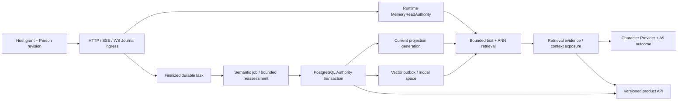

# Phase 2：生产接管、完整性与长期验收

**阶段性交付，R5 整体验收仍开放，真实 Alice 切换仍阻断。** 基于 #325 最新 `11e88bd`；#322→#323→#324→#325 均未合并。独立 worktree/分支 `feat/runtime-memory-r5-phase2`。2026-10-11 实机核对日常安装仍为 `5064c29`。没有修改、重启、部署她的安装、配置、数据库或 QQ。

## 已接入生产调用方的结构

Host 凭据由带显式 operator bearer 的本地管理请求签发，绑定实际存在、有 revision 的 Person 与当前 Character。它证明 Host 认可的传输主体关联，不宣称生物身份认证。凭据仅签发时返回明文、库中保存摘要；轮换共享稳定 principal，撤销/过期失效；Person revision 不再匹配时也失去传输和当前读取授权，需要重新签发绑定，原 Journal 历史不删。消息名字、subjectUserId、sessionId 和模型均不能生成权限。Memory 产品读取和维护在所有模式均需显式本地 operator bearer；production loopback 或普通会话 Host token 不赋予管理披露权。全局 session 归属行防止短期 Conversation 历史被另一主体复用。匿名仍 UNKNOWN；已有匿名会话不能被静默认领。语音入口还没有可信 Host 接入，保持限制。

正常完成来源通过 Journal 原始文本进入持久语义任务；提取前已有稳定任务身份。新 Authority 不采用关键词 veto 或规则 fallback。模型失败保持可检查的等待/失败，聊天不等待远端提取。纠正命题、来源时间/commitSeq、关系及投影同事务提交；原任务 digest 不被重写。冻结目标过期后最多三代真实语义重评，独立租约、最终映射与正式提交同事务；支持关系不会增加当前知识副本。晚到旧来源不能按 worker 完成时间覆盖后来认识。重评如果丢失原纠正关系、变成无关 new fact，会保持 UNRESOLVED 并留下可重试状态，不能偷偷创建另一个现行认识。

当前读取使用物理投影的 scope + scalar generation 查找，避免视图 JOIN 导致全 scope 排序。向量先 HNSW 选有界候选再核验现行状态，适配 pgvector iterative scan 和 ef_search；只做有界 RRF 融合。Embedding 等待期间若发生纠正，候选在一个数据库快照中重新解析状态/版本，至多一次有界文本刷新；不重复远端 embedding 调用。已失效候选不进入模型。

检索 run 关联用户 trace 和真实 Journal 来源，再由原生来源关联 Character 子调用 manifest/exposure，最后查 A9 Provider effect 结果。PREPARED_FOR_USE 与实际 APPLIED 分开；候选证据上限、旧证据完整性 UNKNOWN、context/consumer 上限都显式表示。不保存公开原始 prompt、Host bearer 或私人全文。见[真实关联](evidence/phase2/retrieval-live.json)。当前仍缺 ANN 内部被过滤候选的完整解释和所有预算决策，不能称为完整 Retrieval Evidence 验收。

## 迁移与维护

SQL 027–032 接入身份、检索、来源审计、重评与受认证恢复；033 建立在线 shadow 投影，034 索引实际 context→effect 查找，035 持久旧数据工作流，036 明确检索证据完整性。schema migration 使用专用连接、schema advisory lock、SQL+摘要回执同事务，不再每次重播所有历史 SQL；应用启动只读核对 required receipts。部署须先迁移后启动，旧 runner/旧代码不能直接操作 033 后的同名 view。

投影重建按历史版本扫描 shadow、捕获 active 写入的增量、持久检查点/暂停恢复、追赶后以短 writer lock 原子切换 generation；旧 generation 分批退休。权威历史不修改。来源审计检查 Admission/摘要/Journal selector/身份/时间/关系/投影/索引/回执，证书仅对应已验证版本，后来修改撤销证书。最新11条正常 Runtime 历史的来源点检证书为 VERIFIED、issues/incomplete=0；新知识形成前的旧证书失效，[水位证据](evidence/phase2/source-audit-final.json)。当前没有持续写入场景下完整增量来源水位和全域自动修复，Overview 不伪造 VERIFIED。

受限应用角色与 schema owner/migrator 分离。独立 `operations/provision-roles.sql` 只由另行授权的 operator 执行，不属于自动迁移。生产 Authority 拒绝超级用户、建表/建角色或能修改权威历史的数据库身份。实际应用角色可以提交 Authority 和切换 shadow，不能 UPDATE/DELETE/TRUNCATE 历史、DDL 或伪造迁移回执。正常纠正不等于隐私删除；完整清除合同尚未验收。

`MemoryLegacyWorkflow` 有实际 `/memory/v1/operations` 消费者：显式选择隔离 PostgreSQL 旧副本的 Person/Persona 绑定、keyset 快照、不可变 payload digest chain、同事务批次导入/检查点、源/目标逐条摘要与行数复核、持久操作审计、暂停/恢复。不同 scope/同 ID 不同绑定拒绝。源变化成为 SOURCE_CHANGED；不需要手改数据库来续跑正常批次。250 条测试证明恢复/并发批次/原子回滚/对账。导入记录全部保留为 LEGACY_UNVERIFIED，可在 timeline 查看；Runtime 明确 PARTIAL 而非声称没有旧记忆。IMPORT_VERIFIED **仅指归档完整**，activation 仍是 BLOCKED_SOURCE_REVIEW_REQUIRED。原副本不改；回退不删除新增权威历史。

此流程尚未覆盖 raw Mem0、Dream/Profile、旧 correction、缺身份记录、pending ingestion 的全资产迁移。没有正式生产切换按钮或已验证逆向迁移。Authority 模式旧 `/memory` CRUD/search 返回 410 和 successor；旧 maintenance 只保留 Conversation 恢复，不运行 legacy 过期/关键词失效。显式 legacy 后端为未迁移安装保留，不能据此宣称全产品双轨已退役。

## 实际实验

- 正常 `/message`，自然提及 A + 独立茶叶偏好 →持久任务完成 →独立会话 →自然纠正 B →新进程、空短期上下文仍使用 B、知道 A 无效。另一个 Person 不得到 X 的记忆。同 Person 在另一 Character/Persona 的合法隔离 schema 下，正常真实模型回答没有证据、无原标记泄露；错误使用已有 Character 数据视图则在模型调用前拒绝启动。[Persona 实机隔离](evidence/phase2/persona-isolation.json)。GLM 实机 429 保持失败；仅隔离 Reasoning 改为已有 DeepSeek，原任务恢复。并发旧目标的真实失败保留，通过正式重试和重评收敛为支持关系。[结果与原失败](evidence/phase2/runtime-results.json)、[关系状态](evidence/phase2/runtime-quality-state.json)、[过期任务恢复](evidence/phase2/reassessment-recovery.json)。
- 连续正常 Runtime：稳定偏好、项目决定、重复偏好、分支变化、混合猜测/引用。五个有价值回合正式完成；重复事实形成 supports；猜测/引用回合 skipped。另起新进程后，以不共享中文关键词的英文提问正确召回偏好与当前分支。不是工具结果学习或多年质量证明。早期 dirty 实现实验与最终 `03e60e2` Server 复测分开标记。
- DeepInfra Chat 与恢复后的 Reasoning：`deepseek-ai/DeepSeek-V4-Flash-0731`，temperature=0、max_tokens=2048；初始 `zai-org/GLM-5.3-Flash` 不可用。实际本机 Qwen 512 维用于正常 Runtime。57 次远端调用中 55 次有 usage，共 92,674 输入 / 2,639 输出 token；Provider estimated_cost 合计 0.00534426，两个错误调用费用未知，不能当作最终账单。120 次调用上限；原子费用预算账本未实现。[逐调用元数据](evidence/phase2/model-calls.csv)。2026-10-11 官方标准价格为输入 $0.06、输出 $0.18、缓存输入 $0.015 / 百万 token；只作核对，账单以 Provider 为准。[官方价格](https://deepinfra.com/deepseek-ai/DeepSeek-V4-Flash-0731)
- 真实 PG16.15 + pgvector0.8.6，10k/100k/1M **合成** 512D 向量。旧 JOIN 在百万级全量计划出现数秒查询，停止无意义重复，未捏造最终 p95。首次 ANN 近邻 4/5 的失败保留；ef_search 调整后为 5/5，零旧命题泄露。百万级热缓存分页 p95 2.76ms、向量 p95 13.62ms，4 reader 的 200 请求 1.29s。[失败](evidence/phase2/vector-first-ann.json)、[修复测量/计划](evidence/phase2/vector-ef200.json)。百万向量不是百万真实 LLM embedding，也不是广泛 Recall@K 验收。
- 百万历史在线重建约 48.1s，读 1,724 次 p95 2.50ms、并发正式写 50 次 p95 11.08ms、max 24.10ms；暂停后重新构造组件恢复，增量追赶/切换后 1,000,050 条、全部投影状态对照差异 0。[在线负载](evidence/phase2/online-million.json)。不是强停过程中在线重建恢复验收。
- **自己的** 31508 PostgreSQL cluster 两次 immediate 强停：COMMIT 前中断 → down 时 UNKNOWN →恢复后 not_applied；COMMIT 已执行、回执被注入丢失并强停 →UNKNOWN→恢复后 applied，同键 unchanged。两个最终当前记录均在；vector Provider 失败保留 retryable，删除派生 vector 后正式 requeue 恢复。[最终持久状态](evidence/phase2/database-faults.json)。回执丢失属于注入 transport seam，并非所有真实网络分区故障已验证。
- 2026-10-12 CI 捕获并确定性复现 Runtime dispatcher 的 shutdown 回执竞态：UNKNOWN 已提交后旧快照继续执行，数据库拒绝晚到结果而代码仍报告 recorded=true。修复后只接受正式 RECORDED/REPLAY，UNKNOWN 保持、工具零调用；实际 Effects 全套 127 项通过。[原失败及回执](evidence/phase2/dispatch-shutdown-receipt.json)。
- 自有 PG 恢复后百万查询首个 page 7.79ms、vector 64.94ms；后续热 p95 2.42/8.80ms。OS 文件缓存没有驱逐，不冒充冷缓存。向量表+索引约5.97GB，历史约1.37GB，双代投影约1.76GB；机器24逻辑CPU、约46.7GiB RAM。资源记录是恢复后快照，不是构建峰值。[恢复后计划/I/O](evidence/phase2/vector-post-recovery.json)、[资源](evidence/phase2/resources.json)。

## 总体验收矩阵

| 合同           | 实际进展                                                                      | 仍阻断整体关闭的事项                                                     |
| -------------- | ----------------------------------------------------------------------------- | ------------------------------------------------------------------------ |
| A 正常生产链   | 可信 HTTP/SSE/WS 合同、正常 `/message` 主动形成/纠正/重启召回；实际模型和回执 | 各 Host 正式产品配置/QQ/语音合同、Persona 的各入口实机、多消费者接管     |
| B 单一当前认识 | Authority Runtime 与 v1 共投影；Embedding 竞态重验；Authority 下旧 CRUD 退役  | 全产品迁移完成，Dream/Profile/旧 API 及各客户端消费者收敛                |
| C 可靠迁移     | PostgreSQL 隔离副本分批、检查点、digest/count 对账、暂停恢复                  | raw Mem0/派生/未知身份全资产、影子读取差异、真正切换/回退演练            |
| D 语义责任     | 新路径无关键词 veto/规则 fallback；不可用保留任务                             | 旧后端与派生通道正式退役，所有可信观察消费者语义接入                     |
| E 并发收敛     | 过期目标三代重评、实际旧任务恢复、来源 seq/time fence、共享来源隔离           | 多模型重评/同刻因果/乱序/撤回/多 Writer 长压力语义矩阵                   |
| F 扩展能力     | 实际百万合成向量/HNSW、结构化+向量混合 reader、在线并发 writer                | 多 scope/空间升级、完全冷缓存、真实嵌入大规模召回、资源峰值与长期压力    |
| G 完整性       | 持久点检审计、schema ledger、在线 shadow、受限角色、实际停库/幂等             | 持续审计水位、主动对账修复、磁盘满/网络/全部中断阶段、隐私删除与备份恢复 |
| H 产品可观察   | v1 +检索候选/context/实际调用、旧数据工作流状态、认证运维动作、typed Client   | 全 ANN/预算排除解释、分页多跳图/类型筛选/完整指标、worker pause/空间退休 |
| I 长期学习价值 | 正常 Runtime 自然形成/强化/项目/变化/引用抑制与跨语言独立召回                 | 可信工具执行经历、目标与未完成事项、长运行质量/成本/队列统计             |
| J 安全交付     | check/build/全仓 test 与实际 PG 回归；独立分支；未触碰 Alice                  | 最终提交 CI 以 PR 结果为准；整体现存门槛不因 CI 绿而关闭                 |

下一依赖顺序：旧全资产 catalog 与来源映射/迁移差异 →连续 source audit 水位与自动 repair →模型空间及多 scope 混合负载/全部故障阶段 →可信工具观察/目标经验的正常消费者 →完整管理 API/指标 →隔离完整升级、备份恢复与回退演练。**所有这些完成前，不允许声明可以安全接管真实 Alice。**
