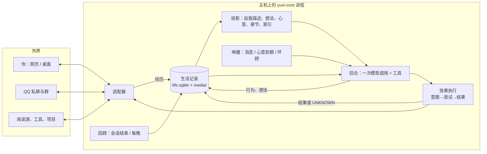

# YUVI V2 蓝图

> 日期：2026-10-19。状态：**规划文档，未实施**。本文不修改 V1 代码，不迁移任何用户数据。
>
> 依据：
>
> - `main` [`0d894cc7`](https://github.com/Ruichen-0079/YUVI/tree/0d894cc70d42ebba0df132924f5ea181c062b431)；
> - 未合并的 R4/R5 堆叠最新端 [`a1b89423`](https://github.com/Ruichen-0079/YUVI/tree/a1b894233767827a714dc19c13456f088da982ae)（#322–#337）；
> - Plunge 分支 [`adff0c70`](https://github.com/Ruichen-0079/YUVI/tree/adff0c70648b42a3a15ea45609adae1c45b31fc5)；
> - 项目史研究（[PR #338](https://github.com/Ruichen-0079/YUVI/pull/338)，提交 `3f6a9393`）；
> - 10-09 前后的五组独立研究（`docs/research/` 下）；
> - 外部文献与一次小规模可行性探针。
>
> 来源索引见[附录 E](appendix-e-sources.md)；术语见文末的“用语速查”。
>
> 读法：
>
> - 只有十分钟：读 §0 一页结论和 §3.10 需要你决定的事。
> - 想知道为什么这样设计：读第一部分（V1 为什么走到这里）和第二部分（理论判断）。
> - 想知道下一步做什么：读 §3.7 第一阶段和 §3.8 路线图。
>
> 标记：
>
> - 带链接的陈述是**证据**；以“我的判断”开头或写明“判断”的段落是**判断**；标为“待实验”的是**假设**。
> - 第二部分里，每个想法注明它是〔继承〕、〔已有未落地〕还是〔新〕。
> - 编号：P1–P8 是继承的研究命题（与 V1 的 P8 软件包无关）；N1–N10 是新判断；S1–S12 是第三部分的设计选择；X1–X11 是 V2 的实验；T1–T3 是研究支线。D1–D12 只指[历史债务](https://github.com/Ruichen-0079/YUVI/blob/3f6a9393a9d5290d2e924df1c7cf1ab72aa5c382/docs/research/project-history/HISTORICAL_DEBT.md)中的条目；“V1 研究方法中的 E7/E8”指 V1 文档的旧编号。

## 0. 一页结论

**V2 是什么。** V2 是一个以“生活记录”为本体的个体运行时。

- **记录什么：** YUVI 经历的一切（听到的、看到的）、做过的一切（说了什么、选择沉默、定下要做的事、调用了什么）、想过的一切（形成的看法和感受），都按时间写进同一份只追加的记录。
- **模型做什么：** 可替换的语言模型阅读这份记录来生活，并把自己的想法写回记录。
- **程序做什么：** 程序负责可核验的事——谁、何时、在哪、回复谁、是否送达、引用是否真实、谁能看到。意义由模型判断。

**七个关键判断：**

1. **V1 最根本的缺口不是记忆不够准，而是 YUVI 没有自己的生活史。** V1 记住的是用户，不是 YUVI。助手说的话不进入长期记忆，沉默不被记录，人格是一段静态风格说明，情绪是给用户贴的关键词标签（第一部分）。V2 的第一件事，是让 YUVI 的行为和想法成为它的经历。
2. **“语义交给模型”与“换模型仍是同一个体”会互相冲突，除非模型形成的理解本身被记录为历史。** V2 把每个想法当作一个事件，带时间、模型版本和出处。新模型继承旧想法，就像人继承自己过去的看法：可以修正，但修正本身也进入历史（N1）。
3. **想法不能证明想法。** 能支持一个看法的，只有外界来的经历（别人说的、外部工具返回的）和 YUVI 实际做过的事，不包括它以前的想法，也不包括模型自己生成的内容；而且 YUVI 做过的事只能支持关于它自己的看法。这条规则取代 V1 “助手内容一律不算证据”的过度禁令，同时防止自我强化的漂移（N2、N3）。
4. **原文优先，而且现在很便宜。** 模型直接阅读按时间排列、带作者的原始事件流；较早的生活通过模型自己写的“章节”（一段时期的摘要）和按需回忆进入。只追加的记录天然适合前缀缓存。按第三方整理的报价估算，连同回顾和群聊在内，每天约一美元（待实测，N7）。
5. **一次模型调用完成一个回合。** 废除“gate JSON + 正文”的两次调用和 Character/Cognition 分工。说话、沉默、回忆、查看、记下想法、定下“心意”（YUVI 自己打算以后做的事），都是同一次调用中的工具。
6. **一个常驻进程，一个 SQLite 生活文件。** 生活文件是唯一不可替代的资产，其余（索引、投影、缓存）都可重建。这个文件可以复制、分叉、消融、换模型重放，因果实验因此从“文档里的方法论”变成日常工具（N8）。
7. **先让一段生活发生，再研究它的内部状态。** 持续内部状态、数值情绪动力学、个体权重都保留为研究支线，但检验它们需要真实的长期轨迹。V1 在没有真实轨迹的情况下建造研究地基，结果地基一直在加高（第一部分）。

**与 V1 的根本差异：**

- V1 是“程序拥有身份，模型是表达层”；V2 是“记录是个体，模型是读写它的心智”。
- V1 的核心是“证明自己保存了什么、没有越权”；V2 的核心是“过去是否改变了未来，能否用消融检验”。

**第一阶段（3 周）：**

- **建什么：** 在你的 Linux 主机上跑起一个只有网页对话的 V2 开发实例。它是导入的 Alice 历史的一个**有名字的分叉**（`v2-dev`），只和你对话，不进入 QQ。
- **做到什么：** 完成单次调用回合、完整的自我记录、章节与回忆、每晚回顾，以及分叉重放工具。从第 2 周起你每天使用它。
- **实验：** 第一阶段比较“原文优先”与 V1 式“检索压缩”（X1）；“有无自我记录”的比较（X2）需要两周真实使用，在第二阶段第一周评估。
- **期间：** 真实的 Alice 继续运行在 V1 上，直到第二阶段的门槛通过。

**最需要你亲自审阅的争议点**（详见 §3.10）：

- 研究排序：生活先于状态；
- YUVI 离线时能否有真实的后台活动；
- V2 是否继承 Alice 的生活史；
- 常驻主机，而不是“一体化桌面应用”；
- 新仓库还是旧仓库。

---

# 第一部分　V1 回顾：为什么走到这里

## 1.1 V1 实际上是什么

先说清楚 V1 在代码中的样子，不按文档的愿景，也不按验证记录的标题。行号均指 `main` `0d894cc7`；完整路径见[附录 A](appendix-a-v1-reality.md)。

**一次普通回复：**

1. **预处理。** 运行时保存用户消息，恢复最近对话，然后用关键词做两件事：
   - 检测“当前情绪”（[`runtime-orchestrator.ts:3710`](https://github.com/Ruichen-0079/YUVI/blob/0d894cc70d42ebba0df132924f5ea181c062b431/packages/core/src/runtime-orchestrator.ts#L3710)）；
   - 检测“忘记请求”，并在检索之前删除 Mem0 记忆（[`:3720`](https://github.com/Ruichen-0079/YUVI/blob/0d894cc70d42ebba0df132924f5ea181c062b431/packages/core/src/runtime-orchestrator.ts#L3720)）。
2. **组装提示。** 检索与当前文本相似的记忆，组装 L1 情节与时间提示。
   - 提示中写着“不要编造间隔期间的事件、感受或屏幕外的生活”（[`:3793`](https://github.com/Ruichen-0079/YUVI/blob/0d894cc70d42ebba0df132924f5ea181c062b431/packages/core/src/runtime-orchestrator.ts#L3793)）；
   - 风格写着“温暖、简洁……1–3 句”（[`:3778`](https://github.com/Ruichen-0079/YUVI/blob/0d894cc70d42ebba0df132924f5ea181c062b431/packages/core/src/runtime-orchestrator.ts#L3778)）。
3. **发给模型。** 这些内容被序列化成 JSON，放在 `Semantic context:` 之后发给模型（[`character-runtime.ts:507`](https://github.com/Ruichen-0079/YUVI/blob/0d894cc70d42ebba0df132924f5ea181c062b431/apps/server/src/character-runtime.ts#L507)）。系统提示的第一句是“You are the bound Character's expression layer”（[`:114`](https://github.com/Ruichen-0079/YUVI/blob/0d894cc70d42ebba0df132924f5ea181c062b431/apps/server/src/character-runtime.ts#L114)）。
4. **两次调用。** 第一次调用只返回一个 JSON 处置（RESPOND / SILENCE / TERMINATE / NEED_COGNITION），第二次调用才生成正文。需要推理时，还要再经一次 Cognition 往返。
5. **沉默不留痕。** 如果处置是沉默，函数直接返回：不保存助手消息，也不写记忆（[`runtime-orchestrator.ts:2301`](https://github.com/Ruichen-0079/YUVI/blob/0d894cc70d42ebba0df132924f5ea181c062b431/packages/core/src/runtime-orchestrator.ts#L2301)）。
6. **只记用户。** 否则保存回复，并由规则抽取器从**用户**的话里提取记忆。代码注释写明：“assistant prose is context and never a source of long-term memory”（[`ingestion.ts:45`](https://github.com/Ruichen-0079/YUVI/blob/0d894cc70d42ebba0df132924f5ea181c062b431/packages/memory/src/ingestion.ts#L45)）。

**身份**由两部分组成：

- 一句 `"You are YUVI, a local-first AI companion runtime agent."`（[`character-identity.ts:33`](https://github.com/Ruichen-0079/YUVI/blob/0d894cc70d42ebba0df132924f5ea181c062b431/packages/core/src/character-identity.ts#L33)）；
- 一段人设风格说明，按句切成“作者不变式”（[`production-invariants.ts`](https://github.com/Ruichen-0079/YUVI/blob/0d894cc70d42ebba0df132924f5ea181c062b431/packages/p8/src/production-invariants.ts)）。其中要求“让熟悉感和连续性从提供的 Memory/P8 上下文中浮现”。

**主动性**是每 60 秒一次的评估（[`:1700`](https://github.com/Ruichen-0079/YUVI/blob/0d894cc70d42ebba0df132924f5ea181c062b431/packages/core/src/runtime-orchestrator.ts#L1700)）：

- 先过硬门槛：同意、抑制、是否在说话、是否有回合在进行等；
- 再由一个分数模型决定是否开口。

**规模：**

- 代码：main 上非测试源码约 16.2 万行，测试约 10.9 万行；`runtime-orchestrator.ts` 一个文件 8,106 行。
- 数据库：25 个迁移、36 张表。
- 进程：生产装配监管 7 个服务（PostgreSQL、Runtime、Mem0、Ollama、本地 STT、两个 TTS 进程），外加 Tauri 外壳、WebUI 和本地嵌入服务。
- 未合并的 R5 堆叠：再加 20 个迁移（026–045），用自建的“记忆权威”取代 Mem0。

**这些事实合在一起说明：**

- V1 的长期记忆是“关于用户的事实”。YUVI 自己说过什么、选择过什么、怎么看待一件事，都不属于它的长期经历。
- 它的人格是作者写好的文本，情绪不存在，主动性是计时器。
- 模型被告知自己是另一个身份的“表达层”。

我的判断：V1 是一个**有严格来源纪律的、关于用户的记忆系统，外面套着一个角色**。这不是贬低，大多数同类项目根本没有这样的来源纪律。但从它到“一个有自己经历的个体”，缺的不是更多地基，而是一样从未被建造的东西：YUVI 自己的生活史。

## 1.2 因果链：五个相互强化的机制

完整证据见[项目史](https://github.com/Ruichen-0079/YUVI/blob/3f6a9393a9d5290d2e924df1c7cf1ab72aa5c382/docs/research/project-history/PROJECT_HISTORY.md)和[历史债务](https://github.com/Ruichen-0079/YUVI/blob/3f6a9393a9d5290d2e924df1c7cf1ab72aa5c382/docs/research/project-history/HISTORICAL_DEBT.md)。这里只讲因果。

**① 起点是助手，不是个体。**

- 05-10 的 `AGENTS.md` 把项目定为“受 AIRI 启发的 AI 伴侣运行时”，并写下两条规则：“记忆绝不能是原始聊天记录”；“必须检索、排序、压缩、重构后再注入提示”。
- 五个月里这份文件一字未改，每个编码代理每次都会读到它。
- 于是第一代记忆为“助手更了解用户”而设计：抽取用户偏好、拒绝保存普通日常经历、给用户贴情绪标签。
- 之后所有“先加工再给模型”的设计，都在这份宪章下获得合法性：L1 摘要、Dream 整合、上下文压缩、语义 section 化。

**② 为不存在的东西预先建边界。**

- 08-28 的路线假设会有一个后训练的小型 Character 模型和一个强 Cognition 模型，于是先造了 Character ABI、Harness 5A–5L、行为规范与偏好数据集。
- 09-01 训练被推迟，这个模型从未出现。但为它设计的“gate + 正文”两次调用一直留在生产里。
- Profile 物化、Dream 触发、P8 解释合同，也都是为尚无读方的消费者建的。[#283](https://github.com/Ruichen-0079/YUVI/pull/283) 发现，合同包根本没接入生产。

**③ 多代理协作的安全机制，变成了系统的概念语言。**

- 08 月起，浏览器里的 GPT 写规格，Codex 实现和审计。
- 为了防止代理互相覆盖，路线图用“每个关注点唯一权威”的表格分配所有权；08-31 一天开了 70 个 PR。
- authority、admission、fail-closed 这些词适合约束代理。但它们一旦进入 YUVI 的概念模型，“一个内部状态同时影响多种行为”这类研究设想就天然显得越权。

**④ 每次思想推进，都被翻译成更多地基。**

- 09-19 的北极星提出“岁月感”和“生活在自己的生活之中”。
- 09-24 的整合把它改写为“可归因、可纠正、可迁移的因果历史”，同时把 Life Layer 和各种心理标量列为排除项。
- 可归因、可纠正都是对的要求。但它们首先被实现为日志准入、效果账本、记忆权威、发行候选、冷恢复……每完成一层，又暴露出新的正确性缺口。
- 09-12 说 v0.1.3 是“最后的地基版本”；到 10-19，开放的堆叠里仍写着“不能切换真实 Alice”。

**⑤ 研究命题从未变成一个运行中的实验。**

- 研究方法文档里有 E1–E8、预注册、消融和失败判据，但长期轨迹生成器和回放设施从未建成。
- 真实模型实验通常每组只做 3 次；发行候选用的是 fixture 模型，“真实模型 B”被阻断。
- 没有实验数据，就没有任何结果能告诉团队“地基已经够了”或者“这个方向错了”。于是地基只能根据想象中的失败继续加固。

这五条互相强化：

- 宪章（①）让程序替模型做理解；
- 代理流程（③）让每一种理解都需要一个程序拥有者；
- 假想模型（②）留下了不必要的结构；
- 没有实验（⑤），这些结构就删不掉；
- 哲学推进（④）只能以更多地基的形式落地。

**归结为一句话：V1 把“忠实地知道发生了什么”做到了很高的水平，却没有建造“这些事情发生在谁身上”。**

## 1.3 V1 做对了什么

不迎合“推倒重来”的冲动。下面这些是真实的成果。V2 应当继承它们的思想，部分继承代码：

- **只追加的生活日志**（Life Event Journal，迁移 013）。事件有提交序号、父事件 DAG、载荷保留状态（保留 / 已删改 / 未保留 / 不可用）。这是一个好设计，可以几乎原样移植到 SQLite。
- **归因。** 说话者、所涉主体、来源三者分开；声纹匹配不等于身份认证（[#245](https://github.com/Ruichen-0079/YUVI/pull/245)、[#249](https://github.com/Ruichen-0079/YUVI/pull/249)）。
- **`UNKNOWN` 效果语义。** 意图 → 尝试 → 结果；崩溃后不重放、不伪造成功（A9、[#329](https://github.com/Ruichen-0079/YUVI/pull/329)）。
- **纠正语义。** 新认识取代旧认识，但保留历史（R4/R5；[#324](https://github.com/Ruichen-0079/YUVI/pull/324) 真实模型 3/3）。
- **原文比截断和摘要好。**
  - [#323](https://github.com/Ruichen-0079/YUVI/pull/323) 一并修复 800 字截断、SSE 心跳丢正文和 `length` 整体拒绝之后，事实召回从 0/3 变成 3/3；
  - Plunge 分支的线性上下文把真实请求从 9,885 字符降到 4,642 字符，同时保留了作者语义。
- **R5 的语义提示**（[`semantic-policy.ts:304`](https://github.com/Ruichen-0079/YUVI/blob/a1b894233767827a714dc19c13456f088da982ae/packages/memory/src/authority/semantic-policy.ts#L304)）。它要求：
  - 模型为每个命题给出原文中唯一的精确引文；
  - “助手的问题不是用户的断言”；
  - “用户的断言是自述，不是已核实的真相”。

  这是 V2 回顾任务现成的提示材料。

- **单机 Linux 上的激活、恢复与冷恢复**（[#336](https://github.com/Ruichen-0079/YUVI/pull/336)、[#337](https://github.com/Ruichen-0079/YUVI/pull/337)）的操作知识。
- **身体：** 本地 STT（sherpa-onnx + 声纹库）、TTS 包装、Live2D Cubism 集成、Tauri 外壳、QQ/SnowLuma 适配器。它们与研究无关，但都是能用的器官。
- **验证纪律：** 把“合成负载”“fixture 模型”“真实模型”分开报告。

## 1.4 V1 留给 V2 的硬结论

| 结论                                                 | 证据                                                                                                | V2 怎样使用                                                                                                                                                                                                                                                                |
| ---------------------------------------------------- | --------------------------------------------------------------------------------------------------- | -------------------------------------------------------------------------------------------------------------------------------------------------------------------------------------------------------------------------------------------------------------------------- |
| 程序侧的语义判断在边缘情况下系统性出错，而且错误隐蔽 | 关键词情绪把“解释 anxious 这个词”判为焦虑；“Don't forget”被理解成删除；协议失败被合成为“成功的沉默” | 程序不做语义过滤，只做可核验的关系                                                                                                                                                                                                                                         |
| 很多“记忆失败”其实是上下文管道的失败                 | #323：截断；SSE 心跳丢正文；`length` 整体拒绝                                                       | 原文优先；上下文预算按模型实测设定，而不是不论模型窗口多大都封顶 24,576 token（未配置窗口时为 12,288；[`context-compression.ts:173`](https://github.com/Ruichen-0079/YUVI/blob/0d894cc70d42ebba0df132924f5ea181c062b431/packages/memory/src/context-compression.ts#L173)） |
| 派生解释必须锚定精确原文                             | A10.1a 用桩模型复现：LLM 抽取路径会把编造的偏好写成“用户说过”                                       | 程序核验每个引文是否真实存在                                                                                                                                                                                                                                               |
| 纠正必须是一等路径                                   | #324 之前，自然语言纠正产生零候选                                                                   | 取代关系是想法的基本操作                                                                                                                                                                                                                                                   |
| 没有消费者的结构不会变成能力                         | #283；Profile 无人读取；Dream 的空闲触发在生产中从未发生                                            | 每个结构必须在同一阶段有读方和实验                                                                                                                                                                                                                                         |
| 测试证明的是基础设施，不是假说                       | 发行候选用 fixture 模型；真实模型实验 n=3                                                           | 每个阶段以真实模型的行为实验结束                                                                                                                                                                                                                                           |
| 真实模型实验的金钱成本可以忽略                       | 历次实验的费用以美分计                                                                              | 不以费用为理由减少实验；真正的限制是凭据与设施                                                                                                                                                                                                                             |

---

# 第二部分　值得继承的思想与新的理论判断

## 2.1 继承的研究命题〔继承〕

这些命题来自 Future 各版本和你的陈述，详见[研究基础](https://github.com/Ruichen-0079/YUVI/blob/3f6a9393a9d5290d2e924df1c7cf1ab72aa5c382/docs/research/project-history/RESEARCH_FOUNDATIONS.md)。V2 把它们当作要检验的命题，而不是已实现的特性。

| #   | 命题                                       | V2 中的位置                                          |
| --- | ------------------------------------------ | ---------------------------------------------------- |
| P1  | 过去必须改变未来，而不只是可被回忆         | 第二阶段的因果消融实验（X3）                         |
| P2  | 同一段生命跨越可替换的机械                 | 生活记录即个体；第四阶段的换模型实验                 |
| P3  | 程序忠实记录，语义交给模型                 | 程序与模型的分工（§3.2），有修正（N1、N6）           |
| P4  | 自我生成不能自证，但真实的选择与后果是经历 | “想法不能证明想法”规则（N2）                         |
| P5  | 人格有惯性而非刚性                         | 分层自我描述与晋升门槛（S5，X4）                     |
| P6  | 内部生活是慢变量，先改变注意，后才可能行动 | 心意、内感受事实与回顾（S6）；数值动力学作为研究支线 |
| P7  | 岁月感来自时间印象，而不是日期查询         | 章节、带时间的想法、真实的离线活动（N5）             |
| P8  | 社会参与回应有证据的机会，而不是回复压力   | 场景、可见范围与环顾预算（S8）                       |

继承的工程原则：

- 记录与解释分层；
- 归因是一等公民；
- 不伪造确定性；
- 纠正是常态；
- “模型提议、系统提交”只用于外部效果、身份绑定和关于世界的事实；
- 机械可替换，经历不可替换；
- 最小充分机制，加上可证伪的比较。

## 2.2 已经提出但从未落地的想法〔已有未落地〕

10-09 的三份研究已经提出了下面这些想法：[从零设计](../research/next-generation-architecture/YUVI-Clean-Sheet-Architecture.zh.md)、[下一代架构评审](../research/next-generation-architecture/YUVI-Next-Generation-Architecture-Review.zh.md)、[持续内部状态研究](../research/persistent-internal-state/YUVI-Persistent-Internal-State-Foundations.zh.md)。V2 采纳它们，不冒充原创：

- **暂定认识。** 有来源、可推翻、影响范围有限的假设，作为“事实”和“无状态”之间的第三种对象。
- **记录选择、机会和结果**，而不只是记录输出。
- **经历的所有者、关于谁、可以告诉谁**，是三个独立的维度。
- **共同情境。** 多人场景中：谁参与、谁知道什么、何时适合发言。
- **单一主模型**，按需求助更强的模型，而不是永久的 Character → Cognition → Character 串联。
- **长寿命是运行条件。** 一生的历史在增长，系统不能因此退化。
- **持续内部状态是一组可反驳的假说。** 学习型、多时间尺度的组织，状态依赖的可塑性；必须与强文本基线公平比较。

## 2.3 新的理论判断〔新〕

以下是本次规划形成的判断。每条写明理由、可能怎样被推翻，以及对设计的影响。

### N1　“语义交给模型”和“换模型仍是同一个体”互相冲突，除非理解本身成为历史

**判断。**

- 如果所有理解都由模型临时完成，那么理解属于模型，而不属于个体。
- 换一个模型读同一份记录，会得出不同的理解。同一段经历，旧模型觉得“她那天只是累了”，新模型觉得“她在回避我”。此时“同一个体”只剩下数据，P2 落空。
- 反过来，如果为了连续性把理解固化成程序规则，P3 落空。

**解决办法：想法即事件。**

- 模型形成的每个看法和感受，都作为一个事件写入记录，带时间、出处和产生它的模型版本。（YUVI 定下的心意是它做出的行为，同样入记录。）
- 之后的模型（无论是否同一个）读到的是：“我在 10 月 3 日这样认为，依据是这几件事。”
- 它可以修正，但修正是一个新的事件（“重读之后，我觉得那天她不是在回避我”），不是悄悄重新推导。
- 人也是这样：我们不会每天从原始经历重新推出自己的全部看法。过去的看法是自我的一部分，改变它们需要理由。

**对设计的影响。**

- 不存在“记忆库”这个独立的东西。关于用户的事实、对自己的认识、情绪，都是想法事件的投影；心意是行为事件的投影。
- 换模型时不重新推导所有理解（那等于换了一个人），而是让新模型继承旧理解，并逐步修正。
- 外部研究也指出，抽象和摘要会丢失出处（[Always-On Agents 综述](https://arxiv.org/pdf/2606.30306)）。所以每个想法都必须带着它引用的事件。

**怎样可能被推翻。** 实验可能显示：用新模型从原始记录重新推导出的理解，在连续性测评上与继承式没有差别（X11）。那样的话，想法事件对连续性就不是必需的，只是缓存。

### N2　V1 记录的是用户的生活，不是 YUVI 的生活

**判断。**

- “助手的话不能作为证据”这条规则（[#9](https://github.com/Ruichen-0079/YUVI/pull/9)）防的是一个真实问题：模型把自己编的内容当成事实。
- 但 V1 把它推广成了“助手的一切都不进入长期经历”。结果 YUVI 不记得自己上周说过什么、答应过什么、那天为什么没回话。
- 一个没有自传的个体，谈不上连续性。

**区分“行为是事实”和“内容是自述”。**

- YUVI 说了一句话，这件事本身是确凿的事实：它确实在那个时间对那个人说了。
- 这句话的内容只是 YUVI 的自述，不能当作关于世界或他人的证据。
- 前者可以支持“我答应过她周末陪她复习”“我在群里很少参与争论”；后者不能支持“她喜欢黑咖啡”。

社会心理学的自我知觉理论（Bem, 1972）提供了一个有用的类比：人常常通过观察自己的行为来推断自己的态度。V2 允许 YUVI 用自己**实际做过的事**来形成对自己的认识，但不允许用自己**以前的想法**作证据。

**“想法不能证明想法”规则。**

- 支持一个想法的引用，必须指向外界来的经历（别人说的、外部工具返回的、程序计算的内感受事实）或行为（YUVI 实际做过的事）。
- **模型生成的内容不算外界经历。** `think_hard` 交给推理模型得到的结论、`look` 时模型对图片的描述，作者都记为模型，不计入支持；可以计入的是图片本身（以哈希引用）或外部工具的原始返回。
- **行为只能支持关于 YUVI 自己的看法。** “我在群里很少参与争论”可以由行为支持；关于他人或世界的看法，只能由外界经历支持。否则模型可以靠反复说同一句话来给自己制造证据。
- 想法可以引用其他想法作为背景，但不计入支持。
- 每个事件的类别和作者是确定的，所以程序可以核验这条规则。

**部分已有。** 10-09 的研究写过“不能把防止自我叙事循环扩大为不许记录自己如何选择”。本次的增量有两点：一是代码层面的证据，指明 V1 在哪几处丢掉了 YUVI 的自传（§1.1）；二是一条可以由程序核验的支持规则。

### N3　闭环会漂移：长期运行的系统是一个动力系统

**判断。**

- 一旦模型读自己写的想法、再写新的想法，系统就有了反馈回路。
- V1 关心的是“谁有权写入”（权威），从未关心“回路运行几个月后会发生什么”（动力学）。
- 可能出现的失败：
  - 某个错误的看法因为反复被读，变得越来越确定；
  - 情绪在几天里单调下滑；
  - 某个话题成为吸引子，每次对话都绕回去。

**外部证据。**

- 一项对 Reflexion 类代理的研究发现：代理会把自信但错误的任务解释存进记忆，之后反复依据它行动；把自我诊断换成程序给出的失败信号后，错误重复率从 0.64 降到 0.10（[Honest Lying, 2026](https://arxiv.org/pdf/2605.29463)）。
- 一篇代理记忆综述把“自我强化的错误”列为反思式记忆的主要风险：错误的结论会让代理回避本可以推翻它的行动（[Memory for Autonomous LLM Agents](https://arxiv.org/pdf/2603.07670)）。

**对设计的影响。**

- 稳定性是一级研究属性，需要持续测量这几项指标：
  - 想法中自我引用的比例；
  - 没有外部支持的想法数量；
  - 看法的翻转频率；
  - 情绪评价的单调段长度；
  - 话题重复率。
- 这些指标在第二阶段建立（X5），并设置报警线。
- 两道防线：第一道是“想法不能证明想法”；第二道是章节回顾时，让模型检查“哪些看法最近没有新的外部支持”。

**怎样可能被推翻。** 如果 60 天模拟中，没有支持规则的对照组也没有出现可测的漂移，这条规则就降级为卫生习惯。

### N4　只有一个对话者的个体，只能成为对方的镜子

**判断。**

- V1 的 YUVI 只在用户说话时存在，它的全部经历都由同一个人提供。
- 这样的系统即使有完美的记忆，它的“发展”也无法与“用户怎样对待它”区分开：它变得更温柔，可能只是用户变得更温柔。
- 这既是体验问题，也是实验设计问题。要研究“经历改变个体”，个体就得有一部分经历不由单一对话者决定。

**对设计的影响。** 独立的经历通道是研究的前提，不是锦上添花。候选有三个，第三阶段接入其中两个：

- QQ 群里的多人社会生活（Alice 已经有了）；
- YUVI 自己选择阅读的内容；
- 一个它可以长期经营的小项目。

**部分已有。** 10-09 的研究提出了“自主性必须有环境和机会”和“共同项目空间”。本次的增量是把它表述为**混杂变量问题**：没有独立通道，任何“发展”都无法归因。

### N5　离线时间可以是真的〔与先前研究有分歧〕

**判断。**

- V1 的提示要求“不要编造间隔期间的事件、感受或屏幕外的生活”。这是诚实的，但它让“岁月感”无从产生：用户离开一周，YUVI 什么也没经历。
- 10-09 的研究进一步明确：不实现“为了维持存在而持续内心独白”。

我认为还有第三条路：**让 YUVI 在离线时真的做一些事，并如实记录。**

- 可以做的事：每晚回顾当天的对话、写下想法；心意到期时重新考虑一件事；读一读它订阅的内容。
- 这些都是真实的计算、真实的事件，有时间戳，也有花费。
- 于是“你这几天在做什么”就有了诚实的回答：“周二晚上我重读了我们关于毕业设计的对话，想到一个之前没说的问题。”
- 这不是虚构屏幕外的生活，而是**给它一段真实的屏幕外生活**。

**风险。**

- Letta 的 sleep-time compute 也提醒：离线推测的内容可能与之后的实际需要无关（[Letta](https://letta.com/blog/sleep-time-compute)）。
- 后台反思会加剧 N3 的漂移。
- 它有花费。

**对设计的影响。**

- 第一阶段只有每晚回顾。
- 第三阶段再加入有预算的自主活动，并用 X9 检验三件事：你在盲评中是否感到差异；YUVI 是否因此编造了没发生的事；花费多少。
- 如果没有可测的收益，就关闭。

### N6　“忠实记录”本身就是一种解释

**判断。**

- 决定什么算一个事件、以什么粒度保存、哪些感知保留多久，本身就是在决定什么有意义。
- 保存全部屏幕截图和群聊语音，既侵犯隐私又昂贵；有选择地保存，就是程序在做语义选择。
- 所以“程序只做忠实记录”在字面上做不到。

**对设计的影响。**

- 记录策略必须**明示，并且有版本**：每类输入保留什么、保留多久、谁能看到，都写在一份配置里。
- 每次修改记录策略，都作为控制事件记入生活记录。
- 这样，日后研究“YUVI 为什么没注意到某件事”时，可以区分“没有记录”与“记录了但没有理解”。

### N7　成本结构就是架构

**已有部分。** 10-09 的从零设计已经把“长上下文中心”列为应当认真对待的基线。本条的增量是成本结构的论证，以及由此得出的上下文布局。

**判断。** V1 “必须压缩后再注入”的宪章，诞生于长上下文昂贵的时期。有两件事改变了这个前提：

- 模型的上下文窗口已经到了百万 token 的量级（例如 DeepSeek V4，[界面新闻](https://m.jiemian.com/article/14318488.html)）；
- 前缀缓存让重复的前缀几乎免费。

**估算。** 下面的数字基于第三方整理的 DeepSeek V4.1 Flash 报价（[benchlm.ai](https://benchlm.ai/deepseek/api-pricing)、[apidog](https://apidog.com/blog/deepseek-v4-1-flash-pricing/)），**未经官方页面核实**：

- 非高峰报价（每百万 token）：缓存命中 $0.003，未命中 $0.15，输出 $0.60；高峰加倍。
- 一次调用：上下文 6 万 token，九成命中，输出 400 token，约 $0.0013（高峰 $0.0026）。
- 一天的总量，按以下假设计算（非高峰到高峰）：
  - 对话：200 个回合，工具循环平均每回合 1.5 次调用；命中率按 85% 计（上下文尾部的工作段和当前段每次都不命中），每次约 $0.0017，合计 $0.5–1.0；
  - 回顾：每天约 5 次，每次读 10 万 token 未命中的原文、输出 3,000 token，合计 $0.08–0.17；
  - 群聊：一个活跃群，白天 16 小时每 15 分钟环顾一次，每次 4 万 token，合计 $0.07–0.14。
- **合计每天约 $0.7–1.4，每月约 $20–40。** 没有缓存时（例如提供商不支持），对话部分会贵 5 倍左右。

**关键在于：只追加的生活记录与前缀缓存天然契合。**

- 只要上下文的早期部分不变、新内容只追加在尾部，缓存就一直命中。
- 如果每回合都重新检索、重新压缩、重新排序，前缀每次都变，缓存就全部失效。
- 所以 V1 的检索压缩路线，在今天反而可能更贵。

**对设计的影响。**

- 上下文按“越稳定越靠前”排列（附录 C）：身份与自我描述 → 章节 → 本纪元的原文事件流（只追加）→ 活跃的想法与心意 → 当前情况。
- 原文窗口满了，就由模型写一个章节，开启新纪元；缓存只失效这一次。

**风险与验证。**

- 长上下文的质量会下降（中段遗忘）。
- V1 当前通过 DeepInfra 调用模型，缓存行为可能不同。
- 价格可能变化。
- 第一阶段的 X1 会实测质量、命中率和费用。

### N8　生活文件是实验基底

**判断。** V1 的研究方法写了消融、交换和回放，但从未实现。原因之一是结构性的：

- V1 的状态分散在 PostgreSQL 的几十张表、Mem0 集合、声纹文件和若干 JSON 中；
- “单一生命”纪律又（正确地）禁止随意分叉；
- 所以，要做一次“删掉这段经历会怎样”的实验，几乎不可能。

**V2 的做法。**

- 个体的全部不可替代状态都在一个 SQLite 文件里，分叉就是复制文件。可行性探针中，1M 事件、444 MB 的文件复制约需 0.2 秒（附录 E）。
- 研究分叉带有新的分支标识，外部效果全部路由到沙箱，永远不会以真实身份对外行动。
- 于是“删掉一段经历”“换一个模型”“从某天起重放”都成为日常实验工具。

这与“不随意分叉”的原则不冲突。被禁止的是**两个副本同时以同一身份对外生活**，而不是在实验室里研究它的反事实。

### N9　内部状态的第一步是真实的内感受，而不是模拟的驱力

**判断。**

- 09-19 的北极星想要稳态、疲劳、张力；09-24 的整合则把各种心理标量列为排除项。
- 两边都跳过了一个更简单的事实：YUVI 有一些**真实的内部状态**，不需要模拟。例如：
  - 今天已经花了多少预算；
  - 距离上次和某人说话过了多久；
  - 有几件答应的事还没做，拖了多久；
  - 有多少条群消息还没读；
  - 自己最近一次回顾是什么时候。
- 这正是北极星说的“数字原生的内感受”。

**对设计的影响。**

- 程序把这些作为事实提供给模型（可核验），由模型赋予意义：“我今天说得太多了”“已经一周没听到她的消息了”。
- 每个回合的内感受事实存为一条快照事件，这样由它形成的想法可以引用它。
- 未完成的心意带着拖延时长出现在上下文里，这就是“未完成的张力”的事实形式。
- 已有的稳态框架研究主要基于强化学习，而不是语言模型伴侣（例如 [EILS](https://arxiv.org/pdf/2512.22200)）。所以是否还需要程序维护的数值动力学（例如情绪的效价与唤醒度），留给研究支线：作为实验组，与这个最小版本比较（T1）。

### N10　可见范围应当随来源传播

**判断。**

- 多人场景中，YUVI 在私聊里得知的事，不能在群里说出来。但它形成的看法常常混合了多处来源。
- 规则可以是机械的：**一个想法的可见范围，是它所引用的全部来源的可见范围的交集。**
- 例如，引用了与小林私聊的看法，只能进入听众是“小林和 YUVI”或其子集的场景。小林也在场的群聊不行，因为群里还有别人。
- 一个想法能否进入某个场景，取决于该场景的听众是否是这个想法可见范围的子集。
- 这是程序可以核验的关系，不需要理解内容。

**部分已有。** 10-09 的研究提出了所有者、关于谁、听众三个维度。本次的增量是一条可以执行的传播规则。

## 2.4 我对你的几个观点的异议

你要求指出你观点中的根本缺陷。以下是我认为最重要的六点。

1. **P3 不能无条件成立。** 把语义尽可能交给模型是对的。但如果理解只在模型调用中短暂存在，个体就无法跨模型延续（N1）。语义交给模型，**理解的结果必须交还给记录**。

2. **“交给模型”不等于“相信模型对自己的报告”。**
   - 模型会对自己的记忆和行为编造内容（N3 中的外部证据）。
   - 程序不判断意义，但必须核验三件事：模型给出的引文是否真实存在、类别是否正确、可见范围是否越界。
   - 这不是程序替模型理解，而是对模型输出做最低限度的事实核对。

3. **“忠实记录”不是中立的（N6）。** 记录什么本身就是选择，应当明示和版本化，而不是假装程序只是一台录音机。

4. **研究排序：先让生活发生，再研究它的内部状态。**
   - 据 10-09 的[持续内部状态研究](../research/persistent-internal-state/YUVI-Persistent-Internal-State-Foundations.zh.md)记载，你批评过上一轮的研究排序。该研究认同这一批评，认为上一轮设计（经历、认识、承诺为中心）“适合回答‘怎样造出可长期合作的产品’”，并把持续内部状态放到了研究排序的首位。
   - 我同意内部状态是更深的问题，但不同意先研究它。
   - 理由：检验任何内部状态假说（学习型状态、数值情绪、个体权重），都需要几个月的真实生活轨迹，作为训练与对照材料。这样的轨迹至今不存在。
   - 没有轨迹而研究内部状态，就只能用合成数据和 fixture 模型——这正是 V1 走过的路。
   - V2 的顺序是：先建一个以文本记录为自我载体的个体，让它真实地生活几个月。文本自我既是第一个候选机制，也是之后任何内部状态方案都必须战胜的基线。

5. **“一体化桌面应用”与“持续存在的个体”有冲突。**
   - `AGENTS.md` 的目标产品是跨平台的一体化桌面应用。
   - 但一个在 QQ 群里有社会生活、离线时也有真实活动的个体，需要一台常开的主机。笔记本合上，它的生活就停了。
   - V2 建议个体住在一台常开的 Linux 主机上（你现有的那台，或者一台家用小主机）。桌面应用、网页、QQ、语音都是它的客户端。
   - 单机模式仍然支持，只是不作为研究阶段的默认。

6. **V1 最大的单一风险来源，是开发流程本身。**
   - 多代理并行、原子化切分、权威文档，让协作约束变成了系统的概念语言（第一部分 ③）。
   - 如果 V2 仍以同样的方式开发，就会以同样的方式失败。
   - V2 需要：一份很短、以研究为中心的代理宪章（附录 C 有草稿）；以实验而不是原子作为工作单位；由你保留架构决定权。

---

# 第三部分　V2 设计与计划

## 3.1 定位

**V2 是：** 一个持续运行的个体运行时。

- 它维护一份生活记录，让可替换的语言模型通过阅读和书写这份记录来生活。
- 它首先服务于一个研究问题：**真实的经历能否以可检验的方式改变一个个体，并跨越模型更换而延续。**
- 其次，它才是一个好用的伴侣。

**V2 不是：**

- 不是 V1 的重构或迁移项目。V1 继续运行，直到 V2 通过门槛。
- 不是通用代理框架或个人助理。工具能力只按生活的需要添加。
- 不宣称意识、主观体验或人格同一性已被解决。“有经历的个体”是一个功能性的、可检验的目标。
- 不是多平台产品。研究阶段只支持 Linux 主机 + 浏览器客户端 + QQ。

## 3.2 核心架构

### 一个文件就是个体

`life.sqlite` 是唯一不可替代的东西。它的主体是一张按时间追加的事件表。生活事件分三类：

| 类别 | 是什么       | 例子                                                                       | 内容的认识地位                                    |
| ---- | ------------ | -------------------------------------------------------------------------- | ------------------------------------------------- |
| 经历 | 从外界进来的 | 她在私聊里说“明天考试”；群里有人发了图；外部工具返回了网页；内感受事实快照 | 来源的断言或观察，带归因                          |
| 行为 | YUVI 做出的  | 说了一句话；选择不回；查看截图；定下心意（“周五问问她考得怎样”）；调用工具 | 行为本身是事实；话语内容是 YUVI 的自述            |
| 想法 | YUVI 想到的  | “她最近压力很大”（引用三条经历）；“这次没帮上忙，我有点沮丧”               | YUVI 在某个时间、用某个模型形成的看法；可以被取代 |

另有第四类**控制事件**：你或系统做出的变更，例如修改人设、删除内容、换模型、出错。它们记录在同一张表里，但不是 YUVI 的经历，也不计入任何支持。

其余一切都是从事件计算出来的**投影**，可以删掉重建：当前自我描述、活跃的想法、心意列表、章节、全文索引、向量。

### 程序做什么，模型做什么

| 程序（可核验的关系）                             | 模型（意义）                                 |
| ------------------------------------------------ | -------------------------------------------- |
| 谁、何时、在哪个场景、回复谁、附件哈希、是否送达 | 这句话是不是在对我说；她是什么意思           |
| 引文是否真实存在、是否逐字一致                   | 这些经历支持什么看法                         |
| 事件类别与作者；支持计数是否符合支持规则（N2）   | 要不要形成、修改或放弃一个看法               |
| 可见范围的传播；预算；安静时段；同意设置         | 要不要说话、说什么、什么时候再想起这件事     |
| 心意的到期触发；效果的意图→尝试→结果             | 心意到期时还要不要做                         |
| 删除请求的执行，以及依赖它的内容一并失效         | “别忘了这个”是不是删除请求（经你确认才执行） |

### 一个回合怎样发生

1. **唤醒。** 回合的唤醒来源有四种（回顾任务另行调度，见下文）：
   - 有人直接对 YUVI 说话：私聊、@、回复它的消息。这些都是可核验的关系。
   - 一个心意到期。
   - 预算内的定时环顾，分两种：
     - **日常环顾**：每天几次，看内感受事实和未完成的心意，而不是每 60 秒评估一次要不要开口；
     - **群聊环顾**：每个活跃的群按预算定时读一次积累的消息，间隔由 X7 决定（候选为 5/15/60 分钟）。
   - 系统事件，例如重启后检查未决的效果。

   群里与 YUVI 没有直接关系的消息只是积累，等群聊环顾时一起看。

2. **组装上下文。** 按“越稳定越靠前”排列：身份种子与当前自我描述 → 章节 → 本场景当前“纪元”（自上一个章节以来）的原文事件流 → 活跃的想法和心意 → 内感受事实、唤醒原因和新事件。详见附录 C。
3. **一次模型调用。** 模型通过工具行动：
   - `say`：说话（可以多次）；
   - `stay_silent`：明确选择不说；
   - `recall`：回忆更早的事；
   - `look`：查看图片或屏幕；
   - `note`：记下一个想法；
   - `intend` / `drop_intention`：定下或放弃一个心意；
   - `think_hard`：把一个问题交给更强的推理模型；
   - `forget`：提出删除请求，经你确认后才执行。

   工具循环有上限（例如 4 步）。完整签名见附录 C.4。

4. **记录。**
   - 回复先作为“意图”写入，再发送，送达后记录结果。
   - 崩溃导致结果不确定，就记 `UNKNOWN`，不重发。
   - 沉默是一个行为事件。
   - 模型调用失败是一个错误事件，绝不伪装成沉默。

### 一次回顾怎样发生

- **时机：** 场景安静下来之后，或者每晚一次。
- **模型做什么：** 阅读最近的原文与当前想法，然后写出新的想法（引用事件 id 和原文）、修改或放弃旧想法、必要时写一个章节。
- **程序做什么：** 核验引用，计算支持，更新投影。
- **提示：** 回顾任务沿用 R5 语义提示中已经验证过的规则——精确引文、问题不是断言、自述不是真相。

## 3.3 关键设计选择与替代方案

每个选择都写明：比较过哪些方案、选了哪个、理由，以及什么证据会让我改变主意。

### S1　ChatModel 请求响应，还是常驻运行时？

| 方案                                 | 优点                                 | 缺点                                                       |
| ------------------------------------ | ------------------------------------ | ---------------------------------------------------------- |
| A 无状态请求响应（每次聊天临时组装） | 简单                                 | 没有心意、没有离线活动、没有群聊环顾；个体只在被叫到时存在 |
| B 常驻进程 + 持续内心独白            | 时间连续                             | 昂贵；最容易漂移；大部分计算没有意义                       |
| **C 常驻进程，事件驱动唤醒**         | 有心意、有环顾、有回顾；空闲时不花钱 | 需要一台常开的主机                                         |

**选择 C。** 进程常驻，但模型只在有理由时被唤醒。

**会改变主意的证据：** 如果 X9 显示离线活动没有任何可测价值，C 可以退化成“带定时器的 A”。

### S2　记录、记忆、理解与内部状态怎样分层？

| 方案                                                      | 说明                                               |
| --------------------------------------------------------- | -------------------------------------------------- |
| A V1 式：日志 + 独立记忆库（Mem0 或权威表）+ Profile + P8 | 多个存储各有所有者，彼此同步                       |
| B 只有原始记录，理解全部现场完成                          | 最忠于 P3；违反 N1；上下文受限时无法处理一年的生活 |
| **C 一个记录，三类生活事件；其余全是投影**                | 理解以想法事件的形式进入记录                       |

**选择 C。**

- 关于用户的事实、对自己的认识、情绪，都是想法事件的投影；心意是行为事件的投影。不再有单独的“记忆系统”。
- R5 的取代 / 冲突 / 支持关系适用于所有想法。
- 外部文献也认为，情节记忆是长期 LLM 代理缺失的一块（[Episodic Memory 立场论文](https://arxiv.org/pdf/2502.06975)）。V2 的原文事件流就是情节记忆，想法是建立在它上面的语义层。

**会改变主意的证据：** 如果某类投影（例如关于用户的稳定事实）需要与想法完全不同的更新语义，可以为它单独建投影，但仍从同一份记录计算。

### S3　上下文：检索优先，还是原文优先？

| 方案                                                 | 说明                                                              | 风险                                         |
| ---------------------------------------------------- | ----------------------------------------------------------------- | -------------------------------------------- |
| A V1 式：最近几轮 + 检索片段 + 压缩，约 2.4 万 token | 在没有缓存时便宜                                                  | 丢失作者、时序和否定；每轮前缀不同，缓存失效 |
| B 尽量把全部历史放进百万 token 窗口                  | 最忠实                                                            | 质量随长度下降；延迟高；一年后放不下         |
| **C 原文窗口 + 章节 + 模型主动回忆**                 | 本纪元原文（2–12 万 token，由 X1 选定）+ 早期章节 + `recall` 工具 | 模型可能不知道自己该回忆什么                 |

**选择 C，窗口大小待实验。** 这里的“窗口”指原文段（附录 C.5 的第 3 段），不是整个上下文。

- 为了缓解“不知道该回忆什么”，程序可以在当前段附上少量**候选标题**（由全文或向量检索得到，只给标题和日期），由模型决定是否展开。这是“程序推荐、模型决定”。
- 章节是有损压缩。有研究从率失真的角度分析记忆压缩（[Rate–Distortion View of Memory Compaction](https://arxiv.org/pdf/2607.08032)），其要点是：压缩的好坏要用下游决策来评估，而不是看摘要读起来是否完整。所以章节必须引用事件，并在 X1 中按问题正确率评估。
- X1 比较 A、C、C + 候选标题，以及不同的窗口大小。

### S4　单模型，还是 gate + 正文，还是 Character/Cognition 分工？

| 方案                                                           | 每次回复的调用数    | 问题                                                              |
| -------------------------------------------------------------- | ------------------- | ----------------------------------------------------------------- |
| A V1：gate JSON + 正文（+ Cognition 往返）                     | 2（需要推理时更多） | 为一个从未出现的后训练模型设计；JSON 控制与表达分离，造成语义损失 |
| B 小角色模型 + 强认知模型                                      | 2–3                 | 升级判断出错的成本；上下文复制                                    |
| **C 一个主模型，工具调用；需要时用 `think_hard` 交给推理模型** | 1（工具循环有上限） | 依赖主模型工具调用的可靠性                                        |

**选择 C。** 工具调用在主流模型上已经是成熟能力，沉默、回忆、记下想法都可以是工具。

**会改变主意的证据：**

- 主模型在 X1/X2 中工具使用的错误率高于 10%（两个实验都记录这一指标）；或者
- 本地小模型在延迟或隐私上有决定性优势。

出现其中之一，再考虑分工。

### S5　情绪、人格、动机与主动性

**情绪：记录 YUVI 自己的评价，不设数值。**

- 模型在回合或回顾中，可以用 `note` 写下感受（“这次没帮上忙，我有点沮丧”），并引用触发它的事件。
- 感受带着时间进入上下文（“三小时前”“上周二”），随着变旧自然淡出。
- 回顾时，可以把一段时期的心情写进章节。
- 这是“情绪是动力而非标签”的最小实现：惯性来自记录和时间，而不是来自程序积分。
- 数值动力学（效价 / 唤醒度的衰减模型）作为 T1 的实验组，与这个版本比较。

**人格：种子 + 有惯性的自我描述。** 作者写的人设是自我描述的第 0 版。之后的变化分三层：

| 层       | 内容                                     | 怎样改变                                                                                                               |
| -------- | ---------------------------------------- | ---------------------------------------------------------------------------------------------------------------------- |
| 此刻     | 当前对话中的状态                         | 只存在于上下文中                                                                                                       |
| 工作想法 | 对人、对事、对自己的看法                 | 回合或回顾中由模型写下；一段时间没有新的外部支持，就退出上下文                                                         |
| 自我描述 | “我是谁”：长期兴趣、习惯、价值、说话方式 | 只在每周回顾中由模型提出修改；程序检查支持是否分布在足够多的日子和场景中（初始参数：≥3 天、跨度 ≥7 天、≥2 个场景或人） |

- 这个“晋升”规则是 P5“越接近‘我是谁’，越需要更多独立经历才改变”的直接实现。
- 它与互补学习系统理论（McClelland 等, 1995）中“快速的情节记忆 + 缓慢的整合”的分工相似。这只是类比，不是证据。
- 门槛是可调参数，由 X4（惯性与合理修正）确定。
- 你对人设的修改作为“控制事件”记录，而不是伪装成经历。

**动机与主动性：心意，而不是计时器。**

- YUVI 想做的事以“心意”的形式存在，例如“周五问问她考试结果”“读完那篇文章”。
- 心意带有触发条件（时间、某人上线、某个场景有动静）和过期时间。
- 程序到点唤醒；模型醒来后决定做不做，结果记为行为。
- 另有每天几次的日常环顾：模型看看内感受事实、未读消息的数量和未完成的心意，自己决定要不要做点什么。
- “主动开口”不再由沉默时长和分数决定，而由 YUVI 自己的心意决定。

### S6　需要 Life Layer 吗？

**现在不建，也不禁止。** 理由：

- 没有学习信号的数值驱力（“孤独值”“疲劳值”）只是装饰。北极星本身就把“化妆品式的激素变量”列为反目标。
- 但 09-24 的全面禁止同样没有经过检验（[历史债务 D8](https://github.com/Ruichen-0079/YUVI/blob/3f6a9393a9d5290d2e924df1c7cf1ab72aa5c382/docs/research/project-history/HISTORICAL_DEBT.md)）。
- 最小版本已经足够开始：真实的内感受事实（N9）+ 被记录的评价 + 带拖延时长的心意。它覆盖了北极星中“未完成的张力”“认知预算”“情绪惯性”里可以检验的部分。
- 研究支线 T1/T2 的进入条件有两个：有了三个月真实轨迹；文本自我在 X3/X4/X7 中暴露出具体的不足。满足后，再比较数值动力学和学习型状态是否有超出最小版本的价值。

### S7　模型与程序的职责

见 §3.2 的表格。补充三条边界规则：

1. **可逆的语义判断交给模型；不可逆的外部效果需要确认。**
   - “别忘了这个”是不是删除请求，由模型判断。
   - 模型认为是删除请求时，调用 `forget` 提出；删除本身只在你于界面上确认后执行，并记为控制事件。
   - 程序永远不从关键词推断删除。
2. **程序的提示永远不是过滤器。**
   - 程序可以给出候选（检索标题、名字被提到的提示）。
   - 但程序不能因为“看起来与 YUVI 无关”，就让模型看不到一条消息。V1 的 QQ 预过滤正是这样失败的。
3. **程序核验模型输出的形式，不核验其意义。**
   - 核验：引文是否存在、类别与作者是否符合支持规则、可见范围是否越界。
   - 不核验：这个看法是否合理。这交给后来的经历去检验。

### S8　多人社会场景、QQ 与感知

**场景是一等对象。** 每个事件属于一个场景：桌面、某个 QQ 群、某段私聊，或 YUVI 自己。场景有成员，成员决定可见范围（N10）。

**群聊：原文直读，按预算环顾。**

- 直接关系（@、回复 YUVI、私聊）立即唤醒；其他消息先积累，群聊环顾时由模型一次读完，再决定是否参与。
- 不使用 V1 Plunge 分支的本地小模型预过滤。理由（[研究基础 §4](https://github.com/Ruichen-0079/YUVI/blob/3f6a9393a9d5290d2e924df1c7cf1ab72aa5c382/docs/research/project-history/RESEARCH_FOUNDATIONS.md)）：
  - 4B 模型几乎不过滤；
  - 8B 模型对提示敏感；
  - 路由器看不到主模型的理由。
- 群聊环顾的频率由预算决定。X7 比较 5/15/60 分钟三种间隔下的参与质量与费用。
- 粗略量级：一个每天 1,000 条消息的群，白天每 15 分钟环顾一次，每天约 $0.07–0.14（N7）。由于原文只追加，大部分上下文可以命中缓存。

**感知按需。**

- 截屏、看图由模型通过 `look` 请求。V1 的 [#273](https://github.com/Ruichen-0079/YUVI/pull/273) 实现了按需截屏，但当时的视觉模型验收因没有模型而跳过；[#329](https://github.com/Ruichen-0079/YUVI/pull/329) 有 Qwen-VL 的小样本报告。可靠性需要在 V2 中重新验证。
- 感知结果按记录策略保留：默认保留图片哈希和模型的描述（描述的作者是模型，不计入支持），原图的保留期限可以配置。

**QQ 接入复用 Plunge 分支的 SnowLuma 适配器**（[`apps/server/src/plunge/`](https://github.com/Ruichen-0079/YUVI/tree/adff0c70648b42a3a15ea45609adae1c45b31fc5/apps/server/src/plunge)）。其中编解码、传输、图片处理三个模块（含测试约 1,050 行）可以直接移植；同目录下的本地小模型预过滤不移植。

### S9　模型更新与个体连续性

**记录是个体，模型是心智的当前载体。** 换模型时：

1. 新模型继续使用现有投影，把旧想法当作“我过去的看法”继承。
2. 可以安排一次“重读”回顾：新模型阅读章节与自我描述，写下它同意或不同意的地方。这些修正作为普通想法进入历史，而不是静默重算。
3. 连续性测评分四个维度（来自 V1 的 model-replacement 设计）：
   - 事实与承诺；
   - 关系与看法；
   - 规范与边界；
   - 说话风格。

   前三个要求连续，第四个允许有可以声明的变化。

4. 加一项**盲测**：你在不知道是否换了模型的情况下与它交谈一周，看能否察觉，以及察觉到的是什么。

每个想法都记录产生它的模型与提示版本，因此日后可以研究“哪些理解是某个模型特有的”。

### S10　存储

| 方案                                                  | 优点                                                 | 缺点                                                                  |
| ----------------------------------------------------- | ---------------------------------------------------- | --------------------------------------------------------------------- |
| A PostgreSQL + pgvector（V1）                         | 成熟，并发强                                         | 需要守护进程；备份、分叉、打包都很重（V1 为此做了大量进程所有权工程） |
| **B SQLite 单文件（WAL）+ FTS5 + 暴力或扩展向量检索** | 一个文件就是一个个体；复制即备份、即分叉；无守护进程 | 只有一个写者；中文全文检索需要处理                                    |
| C LanceDB 等嵌入式向量库                              | 向量检索强                                           | 记录本身仍需要一个事务库，等于两份存储                                |

**选择 B。** 可行性探针用的是合成数据（附录 E）：

- 100 万个事件（大约相当于多年的重度使用加群聊），文件 444 MB；
- 读取最近 2,000 个事件：4 ms；按场景读取 500 个事件：2 ms；
- 20 万个 512 维向量的暴力检索：15 ms；
- 复制整个文件：0.2 秒。

**一个需要处理的发现：** SQLite 的 trigram 分词器对少于 3 个字的查询**一律返回空**，而大多数中文常用词是两个字——“咖啡”查不到，“咖啡茶”能查到。V2 需要为短查询准备退路：

- 退回到 `LIKE` 扫描；或
- 建立二元组索引；或
- 使用中文分词。

这类细节只有在实际做出探针之后才会发现。

向量检索是否必要，由 X1 的“候选标题”实验组决定。如果需要：[sqlite-vec](https://www.piwheels.org/project/sqlite-vec/) 仍在 0.1.x；在百万级以内，暴力检索已经足够。

### S11　语言、运行时与部署

**TypeScript + Node.js（≥22）。** 理由：

- 可以复用 V1 的 Provider 传输层、QQ 适配器和网页代码；
- 你和代理都熟悉。

**SQLite 的接入：**

- Node 22 内置的 `node:sqlite` 已在本机验证可用：支持 FTS5 trigram，底层是 SQLite 3.50.4。
- 但它在 Node 22 中仍是实验特性，在 v25/v26 的文档中是“发布候选”（[Node.js 文档](https://nodejs.org/download/release/v26.7.0/docs/api/sqlite.html)）。
- 备选是 `better-sqlite3`。

比较过的替代：

- Python：机器学习生态好，但 V1 的 Python sidecar 打包代价很大。
- Rust：与 Tauri 同语言，但研究阶段迭代太慢。

**部署：一台常驻主机，多个客户端。**

- `yuvi-core` 作为 systemd 用户服务，运行在一台常开的 Linux 主机上。
- 网页客户端通过 HTTP/WebSocket 连接；QQ 通过 SnowLuma 适配器连接。
- 语音、Live2D、桌面外壳在第五阶段作为客户端接入。
- 单机模式（主机就是你的桌面）用的是同一个程序。

**打包与跨平台推迟到第五阶段之后**，并且只在研究闭环成立后再讨论。

- `AGENTS.md` 第 12 条（生产不得依赖 Node.js 等）不再作为约束。
- 如果将来需要不依赖 Node 的发行包，可以评估 Node 单可执行文件或其他运行时，届时再验证。

### S12　权重与个体训练

**现在不做。**

- 自我编辑式的权重更新（如 [SEAL](https://alphaxiv.org/abs/2506.10943)）仍未解决灾难性遗忘。
- 个体权重难以删除、迁移和解释。

**V2 只保证一件事：** 生活记录的格式足以在将来生成训练数据——每个事件都有来源、类别和模型版本。

如果将来训练个体适配器，它应当是**可以从记录重新训练出来的缓存**，而不是不可替代的存储。这样换基础模型时，可以重新生成。

## 3.4 与 V1 的根本差异

| 方面           | V1                                                    | V2                                                      |
| -------------- | ----------------------------------------------------- | ------------------------------------------------------- |
| 个体是什么     | 程序拥有的身份；模型是“表达层”                        | 生活记录是个体；模型是读写它的心智                      |
| 长期记忆       | 关于用户的事实；助手的内容不进入                      | YUVI 的全部经历、行为和想法；关于用户的认识是想法的一种 |
| 模型看到什么   | JSON 语义上下文 + 压缩记忆；工作预算上限 24,576 token | 按时间排列、带作者的原文 + 章节 + 想法；按缓存命中设计  |
| 每次回复的调用 | gate JSON + 正文（2 次，需要推理时更多）              | 1 次调用 + 工具                                         |
| 沉默           | 主线上不记录                                          | 一个被记录的行为                                        |
| 情绪           | 给用户贴关键词标签（已撤除）；YUVI 自己没有           | YUVI 自己的评价，作为想法记录，随时间淡出               |
| 人格           | 静态风格说明切成“不变式”                              | 种子 + 有惯性的分层自我描述                             |
| 主动性         | 60 秒评估 + 硬门槛 + 分数模型                         | 自己定下的心意 + 预算内的环顾                           |
| 存储           | PostgreSQL + pgvector + Mem0 + 多个 JSON/NPZ 文件     | 一个 SQLite 生活文件 + 媒体目录                         |
| 进程           | 7 个受监管服务 + 外壳                                 | 一个常驻进程；其余是客户端或可选旁路                    |
| 研究           | 方法论写在文档中，设施未建                            | 分叉、消融、重放是日常工具；每个阶段以实验结束          |
| 开发           | 多代理原子化 + 权威文档                               | 以实验为单位；短宪章；时间盒                            |

## 3.5 继承、复用、重写与删除

**作为思想继承：**

- §2.1 的命题与原则；
- §1.4 的硬结论；
- 09-24 的比较实验设计（B0/B0p/B1/B3 基线、预注册、失败判据），作为工具使用，而不是作为禁令。

**代码复用**（审读后移植，不整包引入）：

| V1 代码                                                                                                    | 用途                       | 阶段               |
| ---------------------------------------------------------------------------------------------------------- | -------------------------- | ------------------ |
| `packages/providers` 中 OpenAI 兼容的流式传输与取消（`openai-compatible-stream.ts`、`transport-abort.ts`） | 模型调用                   | 1                  |
| R5 的语义提示规则（`semantic-policy.ts`）                                                                  | 回顾任务的提示材料         | 1                  |
| 迁移 013 的日志设计（提交序号、父事件、保留状态）                                                          | 生活记录的表结构           | 1（移植到 SQLite） |
| A9 的效果账本语义                                                                                          | 回复与工具的意图→尝试→结果 | 1                  |
| Plunge 的线性上下文渲染思路                                                                                | 原文段的格式               | 1                  |
| Plunge 的 SnowLuma 适配器（`qq-codec`、`qq-transport`、`qq-image`）                                        | QQ 接入                    | 3                  |
| `services/local-stt`（sherpa-onnx + 声纹库）、TTS 包装                                                     | 语音                       | 5                  |
| `apps/web` 中的 Live2D Cubism 集成                                                                         | 形象                       | 5                  |
| `apps/desktop` 的 Tauri 外壳                                                                               | 桌面客户端（如果仍需要）   | 5                  |
| #336/#337 的恢复矩阵                                                                                       | 备份 / 恢复演练的测试用例  | 1–3                |

**重新实现：**

- 回合循环（不移植 8,106 行的编排器）；
- 存储；
- 记忆（作为投影）；
- 主动性；
- 上下文组装；
- 网页客户端（一个最小的聊天页 + 生活检视器）。

**删除，不带入 V2：**

- Mem0 及其 sidecar；
- PostgreSQL 作为运行时存储；
- L0/L1/L2 分层与 Dream 规则整合；
- gate + 正文，以及 Character ABI / Harness / Cognition 分工；
- P8 不变式切分器；
- 关键词情绪；
- 70B 主动决策模型与计时常数；
- 7 个服务的 Supervisor；
- Windows 代码；
- AgentBus；
- 权威顺序文档体系。

**需要实验后再决定：**

- 向量检索是否必要（X1）；
- `think_hard` 升级是否有价值（看 X1/X2 中的使用记录）；
- 数值情绪动力学（T1）；
- 离线自主活动（X9）；
- 桌面外壳用 Tauri 还是浏览器应用（第五阶段）。

## 3.6 数据保护与迁移

**原则：V1 的数据只读、永不修改，至少保存两份（其中一份离开这台机器）。V2 只从副本导入。** 详细清单和步骤见[附录 D](appendix-d-migration.md)。

**需要保护的资产：**

- PostgreSQL：对话、日志、记忆、P8 纠正、情节、Profile、效果账本；如果已安装 R5 发行候选，还有记忆权威表；
- Mem0 的向量集合；
- 声纹库（`speakers.json/.npz`）；
- `proactive-policy.json`、`product-settings.json`、`settings.json`；
- 钥匙串中的密钥（不导出明文）；
- 导入的 Live2D 模型；
- 人设文件（Plunge 分支上的 `docs/personas/alice.md`）；
- SnowLuma 侧的 QQ 历史。

**步骤：**

1. **确认事实。** 哪台机器、哪个版本在运行真实的 Alice？[#323](https://github.com/Ruichen-0079/YUVI/pull/323) 提到安装的是 `5064c29`，需要你确认。
2. **冻结导出。** 由你在自己的机器上执行，脚本在执行前可以审读：
   - 停止服务；
   - 用 `pg_dump` 导出整库，复制文件资产；
   - 生成 SHA-256 清单，保存两份副本；
   - 在临时 PostgreSQL 中恢复一次，验证可读。
3. **导入到副本。** 导入器只读取恢复出的副本，生成 V2 事件：
   - 对话消息成为经历和行为，保留原时间与原 id；
   - V1 的记忆（含 Mem0 文本与 R5 命题）作为“V1 系统当时的抽取”导入。它们是历史上的想法，不是 YUVI 现在的认识；
   - P8 纠正作为你的控制事件导入；Profile 是派生物，只存档，不导入；
   - 沉默在 main 上从未被记录，导入后保持“未知”。
4. **核对。**
   - 事件数与源表行数对账；
   - 随机抽样，由你阅读确认；
   - 任何无法映射的行都列入报告，不丢弃。
5. **切换（第二阶段门槛之后，即进入第三阶段时）。** 真实的 Alice 带着导入的历史，在 V2 上继续生活。V1 停止对外行动，但保留可读，不删除。
6. **开发分叉的去处。** 第一、二阶段的 `v2-dev` 是 Alice 历史的一个有名字的分叉，只和你对话。切换时，Alice 的主线由 V1 的完整导入（截至切换日）构成，`v2-dev` 的经历**不并入**她的自传，而是作为研究档案保留。这样世界上任何时候都只有一个 Alice 在对外生活。`v2-dev` 期间你和它的对话，Alice 不会“记得”；如果你希望保留其中某些内容，只能以“你后来告诉她”的方式进入她的生活。

## 3.7 第一阶段：最小生活循环（3 周）

**目标：**

- 一个能真实使用的 V2 开发实例（`v2-dev` 分叉，只和你对话），YUVI 的行为和想法成为它的经历；
- 用 X1 回答“原文优先是否优于检索压缩”；
- 从第 2 周起开始真实使用，为 X2“自我记录是否带来连续性”积累材料。X2 在两周使用后、即第二阶段第一周评估。

**要建的（仅此而已）：**

1. 生活记录表结构 v0：事件、媒体、投影表；trigram 全文检索，加上中文短查询的退路。
2. `yuvi-core`：
   - 网页对话适配器；
   - 唤醒调度（消息、心意、每日回顾）；
   - 回合执行（一次调用 + 工具，循环上限 4）；
   - 回复的意图→尝试→结果。
3. 回顾任务：在会话结束时和每晚运行；写想法、取代旧想法、写章节；程序核验引用与支持规则。
4. 内感受事实提供器。
5. 导入器（在副本上运行）。
6. 生活检视器：按时间查看事件、想法及其引用、心意，以及每个回合的上下文与花费。
7. 分叉重放工具 v0：复制生活文件，按脚本重放用户输入，外部效果进沙箱。
8. 费用计：记录每次调用的输入、缓存命中、输出与金额。

**明确不建：** 语音、Live2D、桌面外壳、QQ、向量检索（除非 X1 需要）、数值情绪、离线自主活动、打包、多平台。

**实验：**

- **X1 上下文方式。**
  - 材料：在导入的真实历史上，准备 40 个问题，涉及过去的事实、YUVI 自己说过的话、未完成的约定、被纠正过的信息。
  - 比较的方案：V1 式检索压缩（按 V1 默认配置：最近 6 轮、约 6,000 字 + 检索片段 + 压缩）；原文窗口 + 章节；再加回忆工具；再加候选标题。
  - 原文窗口大小：2 万、6 万、12 万 token 三档。
  - 同时记录工具调用的错误率与 `think_hard` 的使用情况（S4 的判据）。
- **X2 自我连续性**（材料在第一阶段积累，第二阶段第一周评估）。
  - 两周真实使用后，问它：“上周你答应了我什么”“那天你为什么没回”“你之前怎么看某件事”。
  - 对照组：从同一份记录中删掉行为和想法事件的分叉。

**支持 / 否定标准：**

- **X1：**
  - 原文优先方案在“自己说过的话”与“纠正”两类问题上，比检索压缩高出 15 个百分点以上，且每日费用低于你设定的上限 → 采纳；
  - 无差异 → 选更简单的方案；
  - 更差（长上下文退化）→ 缩小窗口，加强回忆。
- **X2：** 有自我记录的实例正确率 ≥80%，消融组 <40%，则支持 N2。

**进入条件：** 第零阶段完成，即 V1 数据已经冻结导出，并验证可以恢复。

**可以推迟的：** 一切不在上面清单中的东西。

**不能推迟的：**

- 数据保护；
- 费用计；
- 分叉重放工具——没有它，第二阶段的实验做不了，这正是 V1 的教训。

## 3.8 路线图

| 阶段                 | 时间盒                | 目标                             | 最小工程                                                               | 实验                                                                              | 进入条件                                                      |
| -------------------- | --------------------- | -------------------------------- | ---------------------------------------------------------------------- | --------------------------------------------------------------------------------- | ------------------------------------------------------------- |
| 0 保护与准备         | 1 周                  | V1 数据安全；决定主机            | 导出与校验脚本；表结构草案                                             | 无                                                                                | 你确认真实部署的位置                                          |
| 1 最小生活循环       | 3 周                  | YUVI 有自传                      | 见 §3.7                                                                | X1；X2 积累材料                                                                   | 阶段 0 完成                                                   |
| 2 会改变的想法       | 4 周                  | 过去可检验地改变未来             | 分层自我描述与晋升；支持规则；可见范围传播；完整的重放工具；用户模拟器 | X2 评估（第一周）；X3 因果消融；X4 惯性与修正；X5 漂移与稳定性；X6 情绪评价的作用 | X1 有结论                                                     |
| 3 社会生活与独立经历 | 5 周                  | 真实的 Alice 在 V2 上生活        | QQ 适配器；环顾；一个自主经历通道；有预算的离线活动                    | X7 群聊参与；X8 自身行动与后果；X9 离线生活                                       | 切换门槛（见下）                                              |
| 4 换模型             | 3 周                  | 个体跨模型延续                   | 模型切换流程；连续性测评集                                             | X10 换模型连续性；X11 重读                                                        | 阶段 3 稳定运行 2 周                                          |
| 5 身体               | 按需，可与阶段 4 并行 | 恢复语音、形象、桌面             | 复用 V1 模块作为客户端                                                 | 体验回归检查                                                                      | 阶段 3 完成                                                   |
| T 研究支线           | 持续                  | 内部状态是否有超出文本自我的价值 | 视实验而定                                                             | T1 数值情绪；T2 学习型状态；T3 个体适配器                                         | 至少 3 个月真实轨迹，且文本自我在 X3/X4/X7 中暴露出具体的不足 |

**切换门槛（阶段 2 → 3）：**

- X1/X2 有正面结论；
- X3 显示可测的因果作用；
- 备份恢复演练通过；
- 你连续使用两周后，愿意让 V2 替代 V1 的文字对话。

每个实验的设置、对照、指标、支持 / 否定标准和费用估计见[附录 B](appendix-b-experiments.md)。

**防止“地基无限延期”的规则：**

1. **时间盒到期就做实验。** 用当时已有的系统跑这个阶段的实验，记录结果，由结果决定下一步，而不是“先把地基再完善一下”。
2. **新的基础设施必须指向一个具体实验或一次真实故障。** “将来可能需要”不是理由。
3. **从第一阶段第 2 周起，你每天真实使用 V2。** 生活记录必须持续增长；没有真实的生活，就没有研究材料。
4. **“无差异”也是结论。** 选更简单的方案，删掉没有收益的结构。
5. **文档有预算。** 每个阶段的规格不超过两页；本蓝图按阶段修订，没有“权威顺序”。
6. **不变量只有附录 C 列出的那几条。** 其余一切都可以修改。

**开发协作方式：**

- 以实验为单位开 PR：一个 PR 对应一个实验，或者它最少需要的工程。PR 描述以“这个实验要回答什么”开头。
- 代理可以写代码、跑实验；但架构选择、门槛参数和阶段切换由你决定。
- V2 使用一份新的、很短的代理宪章（草稿见附录 C），不继承 V1 的 `AGENTS.md`。

## 3.9 风险

| 风险               | 表现                                             | 缓解                                                                               | 报警线                                          |
| ------------------ | ------------------------------------------------ | ---------------------------------------------------------------------------------- | ----------------------------------------------- |
| 长上下文质量下降   | 窗口中段的事实被忽略                             | 用 X1 选择窗口大小；章节与回忆                                                     | X1 中大窗口不优于小窗口                         |
| 自我强化漂移       | 某个看法越来越确定；情绪单调下滑；话题成为吸引子 | 支持规则；回顾时检查没有新支持的想法；X5 指标                                      | 无外部支持的想法占比 >10%；情绪评价单调段 >5 天 |
| 费用失控           | 缓存不命中；环顾过多                             | 前缀稳定的设计；每日预算硬上限；费用计                                             | 连续 3 天超过预算的 80%                         |
| 跨场景泄露隐私     | 在群里说出私聊内容                               | 可见范围传播；专门的泄露测试                                                       | 任何一次泄露，即停止群聊接入并修复              |
| 生活文件损坏或丢失 | 唯一的资产不可用                                 | WAL；每日快照；离机副本；恢复演练                                                  | 恢复演练失败                                    |
| 提供商变化         | 价格变化、模型下线                               | OpenAI 兼容抽象；连续性测评                                                        | —                                               |
| 重新开始造地基     | 阶段延期、文档膨胀                               | §3.8 的六条规则                                                                    | 任何阶段超出时间盒 50%                          |
| 过渡期体验倒退     | 没有语音和形象                                   | 切换前 V1 继续运行；第五阶段复用 V1 模块                                           | —                                               |
| 伦理风险           | 用户过度依赖；YUVI 声称拥有人类式的感受          | 允许 YUVI 表达自己的评价，但不声称人类式的主观体验；检视器让你看到它的想法从何而来 | —                                               |

## 3.10 需要你决定的事

1. **研究排序。** 你是否接受“先建一个以文本记录为自我的个体，让它生活三个月，再进入内部状态研究”？这与你此前更偏向“内部状态优先”的立场不同（§2.4 第 4 点）。
2. **离线活动。** 是否允许 YUVI 在你不在时有真实的、有预算的活动（N5）？这与 V1 的提示和 10-09 的研究都不同。
3. **Alice 的生活史。** V2 是继续 Alice 的生活（导入 V1 历史，过了切换门槛后接管真实身份），还是作为一个新个体开始？我建议继续：P2 说，生命不应被随意重置。代价是：开发分叉 `v2-dev` 上的经历不会并入她的自传（§3.6 第 6 步）。
4. **主机。** 有没有一台常开的 Linux 主机可以作为 YUVI 的住处？如果没有，第三阶段的群聊和离线活动会受限。
5. **群聊记录策略。** 群里其他人的消息保留多久？是否只保留文本、不保留图片原件？
6. **模型与预算。** 是否改用 DeepSeek 官方 API 以获得缓存（V1 通过 DeepInfra 调用）？每月费用上限是多少？
7. **仓库。** 新仓库，还是在本仓库中另起目录？我建议新仓库。V1 的 `AGENTS.md`、约 48 MB 的文档和权威体系，会持续影响在本仓库里工作的代理（[历史债务 D1、D11](https://github.com/Ruichen-0079/YUVI/blob/3f6a9393a9d5290d2e924df1c7cf1ab72aa5c382/docs/research/project-history/HISTORICAL_DEBT.md)）。V1 仓库保留为只读参考。

---

## 附录

- [附录 A　V1 现实与数据流](appendix-a-v1-reality.md)：代码路径、数据流、存储清单，带精确链接。
- [附录 B　实验矩阵](appendix-b-experiments.md)：X1–X11 与 T1–T3 的设置、对照、指标、判据与费用。
- [附录 C　数据模型与接口草图](appendix-c-interfaces.md)：事件结构、投影、工具、上下文布局、回顾合同、不变量、代理宪章草稿。
- [附录 D　数据保护与迁移](appendix-d-migration.md)：资产清单、导出步骤、映射规则、核对方法。
- [附录 E　来源与可行性探针](appendix-e-sources.md)：内部与外部来源、探针方法与结果。

## 用语速查

**V2 用语**

| 用语                | 含义                                                               |
| ------------------- | ------------------------------------------------------------------ |
| 生活记录 / 生活文件 | `life.sqlite`：YUVI 全部事件的只追加记录，唯一不可替代的资产       |
| 经历 / 行为 / 想法  | 三类生活事件：从外界进来的、YUVI 做出的、YUVI 想到的               |
| 控制事件            | 你或系统做出的变更（改人设、删除、换模型、出错），不是 YUVI 的经历 |
| 投影                | 从事件计算出的当前状态，可以删掉重建                               |
| 心意                | YUVI 自己打算以后做的事，带触发条件和过期时间；定下心意是一个行为  |
| 章节                | 模型为一段时期写的摘要，引用其中的事件                             |
| 纪元                | 两次章节之间的一段原文；原文段满了就写章节、开始新纪元             |
| 回顾                | 场景安静后或每晚运行的任务：写想法、取代旧想法、写章节             |
| 日常环顾 / 群聊环顾 | 预算内的定时唤醒：前者每天几次看心意与内感受，后者按间隔读群消息   |
| 晋升                | 工作想法进入“自我描述”的过程；需要支持分布在足够多的日子和场景     |
| 内感受事实          | 程序计算的关于 YUVI 自身的真实状态：预算、时长、待办等             |
| 分叉                | 生活文件的副本，带新的分支 id，只用于研究，不能对外行动            |
| 支持规则            | 想法的支持只能来自外界经历和（仅对关于自己的看法）行为（N2）       |

**V1 用语**

| 用语                                | 含义                                                                                                     |
| ----------------------------------- | -------------------------------------------------------------------------------------------------------- |
| A0–A12、A9、A10.1a                  | 09-14 至 10-07 的 V1 工程原子编号。A9 是外部效果的“意图→尝试→结果”账本；A10.1a 是 LLM 记忆抽取的归因验证 |
| L0/L1/L2、Dream                     | V1 的分层记忆（L0 最近几轮原文 / L1 近期情节 / L2 长期记忆证据）与空闲时的规则整合                       |
| Character ABI / Harness / Cognition | 为假想的后训练角色模型设计的接口、执行框架与独立推理模型                                                 |
| gate                                | V1 每次回复的第一次调用，只返回一个 JSON 处置，不生成正文                                                |
| P8                                  | V1 的身份 / 人设包（与本文的命题 P8 无关）                                                               |
| R4/R5                               | 10 月未合并的记忆纠正与“记忆权威”工作                                                                    |
| B0/B0p/B1/B3                        | 09-24 研究方法中的比较基线：原始长上下文、加来源、现行系统、强显式选择                                   |
| fixture 模型                        | 测试中返回固定内容的假模型，只能验证基础设施，不能验证行为                                               |
| admission / fail-closed / authority | V1 的治理词汇：准入、出错时拒绝、唯一写入者                                                              |
