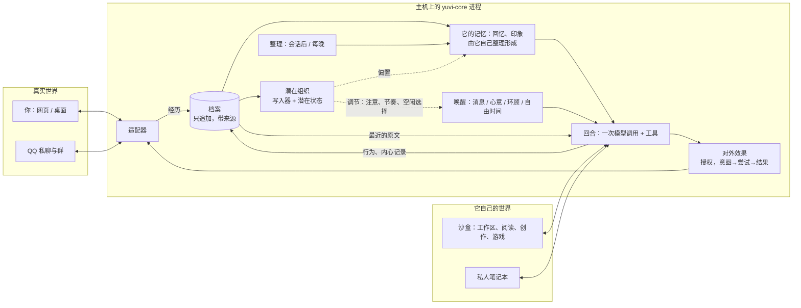

# YUVI V2 蓝图

> 第二版，2026-10-20。状态：**规划文档，未实施**。本文不修改 V1 代码，不迁移任何用户数据。
>
> 第二版根据你对研究宗旨的纠正，重写了定位、第二部分的若干判断、架构与研究排序。第一版见提交 `0ad39377`；为什么改、改了什么，见[修订说明](revision-note-2026-10-20.md)。
>
> 依据：
>
> - `main` [`0d894cc7`](https://github.com/Ruichen-0079/YUVI/tree/0d894cc70d42ebba0df132924f5ea181c062b431)；
> - 未合并的 R4/R5 堆叠最新端 [`a1b89423`](https://github.com/Ruichen-0079/YUVI/tree/a1b894233767827a714dc19c13456f088da982ae)（#322–#337）；
> - Plunge 分支 [`adff0c70`](https://github.com/Ruichen-0079/YUVI/tree/adff0c70648b42a3a15ea45609adae1c45b31fc5)；
> - 项目史研究（[PR #338](https://github.com/Ruichen-0079/YUVI/pull/338)，提交 `3f6a9393`）；
> - 10-09 前后的五组独立研究（`docs/research/` 下）；
> - 你对研究宗旨的说明（2026-10-20）；
> - 外部文献与一次小规模可行性探针。
>
> 来源索引见[附录 E](appendix-e-sources.md)；术语见文末的“用语速查”。
>
> 读法：
>
> - 只有十分钟：读 §0 和 §3.10。
> - 想知道为什么这样设计：读第一部分（V1 为什么走到这里）和第二部分（研究宗旨与理论判断）。
> - 想知道下一步做什么：读 §3.7 第一阶段和 §3.8 路线图。
>
> 标记：
>
> - 带链接的陈述是**证据**；以“我的判断”开头或写明“判断”的段落是**判断**；标为“待实验”的是**假设**。
> - 第二部分里，每个想法注明它是〔继承〕、〔已有未落地〕、〔新〕还是〔修订〕。
> - 第三部分中凡是“不采用”或“暂时这样做”，都注明属于哪一类：**①技术限制下的暂时替代**、**②在特定实验中没有增量**、**③方向本身没有意义**。三者不混用。
> - 编号：P1–P8 是继承的研究命题（与 V1 的 P8 软件包无关）；N1–N14 是理论判断；S1–S14 是设计选择；X1–X20 是实验。D1–D12 只指[历史债务](https://github.com/Ruichen-0079/YUVI/blob/3f6a9393a9d5290d2e924df1c7cf1ab72aa5c382/docs/research/project-history/HISTORICAL_DEBT.md)中的条目；“V1 研究方法中的 E7/E8”指 V1 文档的旧编号。

## 0. 一页结论

**研究宗旨（先于一切设计）。** YUVI 要研究的是：一个人工系统能否形成**自身的、持续演化的、部分隐含的内部组织与生活过程**。

- 它的心境、回忆、联想、想象、兴趣、娱乐与隐私，不被人设、状态字段、任务目标和观察者能看到的行为预先穷尽。
- 不要求证明意识，也不把不透明当作深刻。
- 但不因为一种性质现在难以定义、难以观测或难以工程化，就把它从研究对象中删掉，或换成一个易于记录和验证的替代品并宣布问题已经解决。

**第一版的根本错误。** 第一版把这些性质逐一换成了易记录、易验证的显式表示：心境换成带时间的文字评价，回忆换成准确检索，欲望换成带期限的心意，自主活动换成有预算的后台任务，个体换成“生活文件 + 模型继承”。这些工程各自合理，但合在一起，造出的是一个高度可靠的长期 Agent，而不是研究对象。第一版还把潜在状态研究放在三个月门槛之后，门槛的判据又全是显式行为，等于让最容易实现的架构决定了什么值得研究（§1.5）。

**V2 是什么。** 一个让这样的个体**有机会形成**的研究平台：

- YUVI 在两个世界里生活：真实世界（你、QQ 群）和它自己的世界（沙盒）。
- 程序忠实保存发生了什么，但不替它理解。
- 它的理解、记忆和心境由它自己的过程形成，其中一部分不是文字。

**V2 保存四样东西。** 这是候选架构，不是“个体是什么”的定义：

1. **档案。** 世界对它生活的忠实记录：只追加、带来源。它是研究、审计和对外事实的依据，但**不是它的记忆**。
2. **它自己的记忆与内心记录。** 由它自己形成的回忆、印象、联想、想象，可以不准确，会遗忘、会变形。程序不给它们分类。
3. **潜在组织。** 经历离开上下文之后仍留在它身上、影响它怎样理解与期待的部分。它从经历中学习而来，不预设“快乐、信任、疲劳”之类的语义坐标。研究中。
4. **它的世界。** 一个它可以自己探索、娱乐、工作的沙盒，有自己的动力和反馈，也有不为展示而存在的私人部分。

哪一部分承载“同一个个体”的连续性，是研究问题，不预先回答。

**关键判断：**

1. **档案与记忆分开（N11）。** 准确性的要求只用在边界上：身份、权限与删除所依据的内容，由程序核对来源；对外效果需要授权；对别人陈述事实前先查档，这是规范，并持续测量。内心活动不受这些约束。误认、想象和联想可以是它历史的一部分，但不能被当作事实说出去。
2. **心境按作用定义，而不是按标签定义（N12）。** 心境是经历留下的、满足三个条件的变化：经历离开上下文后仍然存在；带宽很低，从它复原不出经历本身；它改变对新事物的理解与期待。我们用“预测自身后续经历”作为第一个候选的训练目标。把心境读成文字只是三种作用通道之一，另两种是调节过程（回忆起什么、注意什么、等多久、空闲时做什么）和在开放权重模型上直接调节。
3. **心境研究从第一阶段开始，与真实生活并行。** 先在 V1 已有的数月真实历史和公开长对话数据上离线做，第二阶段再接到开发分叉上。三个月门槛取消。
4. **自然语言事件流是一种认识论选择，不是检索技巧（N7）。** 模型直接接触未经预解释的世界，它的理解才可能是它自己的。成本低只是这件事现在可行的条件。
5. **自主生活需要一个有自身动力的世界，以及一个不只来自语言模型先验的价值来源（N13）。** 沙盒给它的是自由时间，不是任务。“学习进展”是这样一个价值来源的候选。它和心境可能出自同一个预测组织，而不是另一个子系统（待实验）。
6. **隐私是围绕数据的安排（N14）。** 私人内容默认不呈现、不为展示而优化；对外效果始终受权限与记录约束；读取私人内容要经过有记录的程序。
7. **第一版中经得起检验的工程保留：** 单次调用加工具、SQLite、只追加档案、`UNKNOWN`、分叉 / 消融 / 重放、数据保护。分叉与交换正是检验潜在组织所需要的工具。

**与 V1 的根本差异：**

- V1 是“程序拥有身份，模型是表达层”。V2 不预先规定个体在哪里，但给出四个候选的载体，并让其中一个——潜在组织——从一开始就进入研究。
- V1 擅长证明自己保存了什么、没有越权。V2 要研究：经历留下的东西能否以不被预先命名的方式改变它；同时保证它对外说的话可信、做的事受约束。

**第一阶段（3 周），两条线并行：**

- **生活线：** 在你的 Linux 主机上跑起一个只有网页对话的开发实例。它是导入的 Alice 历史的一条开发分支（`v2-dev`），只和你对话；它不同于不能有任何外部互动的研究分叉（附录 C.1）。档案与记忆从第一天起就分开；有一个只属于它的私人笔记本。
- **心境线：** 在 V1 历史的本地副本上离线训练写入器与潜在状态，检验它是否满足 N12 的前两个条件（持续、低带宽）、是否在最近窗口之上带来预测增益，以及它是否只是写入器与读出器之间的私有编码。第三个条件（改变行为）要到第二阶段在线检验。
- 真实的 Alice 继续运行在 V1 上，直到第二阶段的门槛通过。

**最需要你亲自审阅的争议点**（详见 §2.4、§3.10）：

- 心境的训练目标：我主张“预测自身后续经历”，但这是一个理论选择，不是中立的工程选择；
- “把心境读成文字”不应是主要通道；
- 沙盒里“它自己的兴趣”，早期多半是语言模型的先验；
- 隐私的边界与审计程序；
- 继承 Alice 的生活史，常驻主机，新仓库。

---

# 第一部分　V1 回顾：为什么走到这里

## 1.1 V1 实际上是什么

先说清楚 V1 在代码中的样子，不按文档的愿景，也不按验证记录的标题。行号均指 `main` `0d894cc7`；完整路径见[附录 A](appendix-a-v1-reality.md)。

**一次普通回复：**

1. **预处理。** 运行时保存用户消息，恢复最近对话，然后用关键词做两件事：
   - 检测“当前情绪”（[`runtime-orchestrator.ts:3710`](https://github.com/Ruichen-0079/YUVI/blob/0d894cc70d42ebba0df132924f5ea181c062b431/packages/core/src/runtime-orchestrator.ts#L3710)）；
   - 检测“忘记请求”，并在检索之前删除 Mem0 记忆（[`:3720`](https://github.com/Ruichen-0079/YUVI/blob/0d894cc70d42ebba0df132924f5ea181c062b431/packages/core/src/runtime-orchestrator.ts#L3720)）。
2. **组装提示。** 检索与当前文本相似的记忆，组装 L1 情节与时间提示。
   - 提示中写着“不要编造间隔期间的事件、感受或屏幕外的生活”（[`:3793`](https://github.com/Ruichen-0079/YUVI/blob/0d894cc70d42ebba0df132924f5ea181c062b431/packages/core/src/runtime-orchestrator.ts#L3793)）；
   - 风格写着“温暖、简洁……1–3 句”（[`:3778`](https://github.com/Ruichen-0079/YUVI/blob/0d894cc70d42ebba0df132924f5ea181c062b431/packages/core/src/runtime-orchestrator.ts#L3778)）。
3. **发给模型。** 这些内容被序列化成 JSON，放在 `Semantic context:` 之后发给模型（[`character-runtime.ts:507`](https://github.com/Ruichen-0079/YUVI/blob/0d894cc70d42ebba0df132924f5ea181c062b431/apps/server/src/character-runtime.ts#L507)）。系统提示的第一句是“You are the bound Character's expression layer”（[`:114`](https://github.com/Ruichen-0079/YUVI/blob/0d894cc70d42ebba0df132924f5ea181c062b431/apps/server/src/character-runtime.ts#L114)）。
4. **两次调用。** 第一次调用只返回一个 JSON 处置（RESPOND / SILENCE / TERMINATE / NEED_COGNITION），第二次调用才生成正文。需要推理时，还要再经一次 Cognition 往返。
5. **沉默不留痕。** 如果处置是沉默，函数直接返回：不保存助手消息，也不写记忆（[`runtime-orchestrator.ts:2301`](https://github.com/Ruichen-0079/YUVI/blob/0d894cc70d42ebba0df132924f5ea181c062b431/packages/core/src/runtime-orchestrator.ts#L2301)）。
6. **只记用户。** 否则保存回复，并由规则抽取器从**用户**的话里提取记忆。代码注释写明：“assistant prose is context and never a source of long-term memory”（[`ingestion.ts:45`](https://github.com/Ruichen-0079/YUVI/blob/0d894cc70d42ebba0df132924f5ea181c062b431/packages/memory/src/ingestion.ts#L45)）。

**身份**由两部分组成：

- 一句 `"You are YUVI, a local-first AI companion runtime agent."`（[`character-identity.ts:33`](https://github.com/Ruichen-0079/YUVI/blob/0d894cc70d42ebba0df132924f5ea181c062b431/packages/core/src/character-identity.ts#L33)）；
- 一段人设风格说明，按句切成“作者不变式”（[`production-invariants.ts`](https://github.com/Ruichen-0079/YUVI/blob/0d894cc70d42ebba0df132924f5ea181c062b431/packages/p8/src/production-invariants.ts)）。其中要求“让熟悉感和连续性从提供的 Memory/P8 上下文中浮现”。

**主动性**是每 60 秒一次的评估（[`:1700`](https://github.com/Ruichen-0079/YUVI/blob/0d894cc70d42ebba0df132924f5ea181c062b431/packages/core/src/runtime-orchestrator.ts#L1700)）：

- 先过硬门槛：同意、抑制、是否在说话、是否有回合在进行等；
- 再由一个分数模型决定是否开口。

**规模：**

- 代码：main 上非测试源码约 16.2 万行，测试约 10.9 万行；`runtime-orchestrator.ts` 一个文件 8,106 行。
- 数据库：25 个迁移、36 张表。
- 进程：生产装配监管 7 个服务（PostgreSQL、Runtime、Mem0、Ollama、本地 STT、两个 TTS 进程），外加 Tauri 外壳、WebUI 和本地嵌入服务。
- 未合并的 R5 堆叠：再加 20 个迁移（026–045），用自建的“记忆权威”取代 Mem0。

**这些事实合在一起说明：**

- V1 的长期记忆是“关于用户的事实”。YUVI 自己说过什么、选择过什么、怎么看待一件事，都不属于它的长期经历。
- 它的人格是作者写好的文本，情绪不存在，主动性是计时器。
- 模型被告知自己是另一个身份的“表达层”。

我的判断：V1 是一个**有严格来源纪律的、关于用户的记忆系统，外面套着一个角色**。这不是贬低，大多数同类项目根本没有这样的来源纪律。但从它到“一个有自己经历的个体”，缺的不是更多地基，而是从未被建造的东西：YUVI 自己的生活史，以及任何不能被显式表示穷尽的内部组织。

## 1.2 因果链：五个相互强化的机制

完整证据见[项目史](https://github.com/Ruichen-0079/YUVI/blob/3f6a9393a9d5290d2e924df1c7cf1ab72aa5c382/docs/research/project-history/PROJECT_HISTORY.md)和[历史债务](https://github.com/Ruichen-0079/YUVI/blob/3f6a9393a9d5290d2e924df1c7cf1ab72aa5c382/docs/research/project-history/HISTORICAL_DEBT.md)。这里只讲因果。

**（一）起点是助手，不是个体。**

- 05-10 的 `AGENTS.md` 把项目定为“受 AIRI 启发的 AI 伴侣运行时”，并写下两条规则：“记忆绝不能是原始聊天记录”；“必须检索、排序、压缩、重构后再注入提示”。
- 五个月里这份文件一字未改，每个编码代理每次都会读到它。
- 于是第一代记忆为“助手更了解用户”而设计：抽取用户偏好、拒绝保存普通日常经历、给用户贴情绪标签。
- 之后所有“先加工再给模型”的设计，都在这份宪章下获得合法性：L1 摘要、Dream 整合、上下文压缩、语义 section 化。

**（二）为不存在的东西预先建边界。**

- 08-28 的路线假设会有一个后训练的小型 Character 模型和一个强 Cognition 模型，于是先造了 Character ABI、Harness 5A–5L、行为规范与偏好数据集。
- 09-01 训练被推迟，这个模型从未出现。但为它设计的“gate + 正文”两次调用一直留在生产里。
- Profile 物化、Dream 触发、P8 解释合同，也都是为尚无读方的消费者建的。[#283](https://github.com/Ruichen-0079/YUVI/pull/283) 发现，合同包根本没接入生产。

**（三）多代理协作的安全机制，变成了系统的概念语言。**

- 08 月起，浏览器里的 GPT 写规格，Codex 实现和审计。
- 为了防止代理互相覆盖，路线图用“每个关注点唯一权威”的表格分配所有权；08-31 一天开了 70 个 PR。
- authority、admission、fail-closed 这些词适合约束代理。但它们一旦进入 YUVI 的概念模型，“一个内部状态同时影响多种行为”这类研究设想就天然显得越权。

**（四）每次思想推进，都被翻译成更多地基。**

- 09-19 的北极星提出“岁月感”和“生活在自己的生活之中”。
- 09-24 的整合把它改写为“可归因、可纠正、可迁移的因果历史”，同时把 Life Layer 和各种心理标量列为排除项。
- 可归因、可纠正都是对的要求。但它们首先被实现为日志准入、效果账本、记忆权威、发行候选、冷恢复……每完成一层，又暴露出新的正确性缺口。
- 09-12 说 v0.1.3 是“最后的地基版本”；到 10-19，开放的堆叠里仍写着“不能切换真实 Alice”。

**（五）研究命题从未变成一个运行中的实验。**

- 研究方法文档里有 E1–E8、预注册、消融和失败判据，但长期轨迹生成器和回放设施从未建成。
- 真实模型实验通常每组只做 3 次；发行候选用的是 fixture 模型，“真实模型 B”被阻断。
- 没有实验数据，就没有任何结果能告诉团队“地基已经够了”或者“这个方向错了”。于是地基只能根据想象中的失败继续加固。

这五条互相强化：

- 宪章（一）让程序替模型做理解；
- 代理流程（三）让每一种理解都需要一个程序拥有者；
- 假想模型（二）留下了不必要的结构；
- 没有实验（五），这些结构就删不掉；
- 哲学推进（四）只能以更多地基的形式落地。

**归结为一句话：V1 把“忠实地知道发生了什么”做到了很高的水平，却没有建造“这些事情发生在谁身上”。**

## 1.3 V1 做对了什么

不迎合“推倒重来”的冲动。下面这些是真实的成果。V2 应当继承它们的思想，部分继承代码：

- **只追加的生活日志**（Life Event Journal，迁移 013）。事件有提交序号、父事件 DAG、载荷保留状态（保留 / 已删改 / 未保留 / 不可用）。这是一个好设计，可以几乎原样移植到 SQLite。
- **归因。** 说话者、所涉主体、来源三者分开；声纹匹配不等于身份认证（[#245](https://github.com/Ruichen-0079/YUVI/pull/245)、[#249](https://github.com/Ruichen-0079/YUVI/pull/249)）。
- **`UNKNOWN` 效果语义。** 意图 → 尝试 → 结果；崩溃后不重放、不伪造成功（A9、[#329](https://github.com/Ruichen-0079/YUVI/pull/329)）。
- **纠正语义。** 新认识取代旧认识，但保留历史（R4/R5；[#324](https://github.com/Ruichen-0079/YUVI/pull/324) 真实模型 3/3）。
- **原文比截断和摘要好。**
  - [#323](https://github.com/Ruichen-0079/YUVI/pull/323) 一并修复 800 字截断、SSE 心跳丢正文和 `length` 整体拒绝之后，事实召回从 0/3 变成 3/3；
  - Plunge 分支的线性上下文把真实请求从 9,885 字符降到 4,642 字符，同时保留了作者语义。
- **R5 的语义提示**（[`semantic-policy.ts:304`](https://github.com/Ruichen-0079/YUVI/blob/a1b894233767827a714dc19c13456f088da982ae/packages/memory/src/authority/semantic-policy.ts#L304)）。它要求：
  - 模型为每个命题给出原文中唯一的精确引文；
  - “助手的问题不是用户的断言”；
  - “用户的断言是自述，不是已核实的真相”。

  这是 V2 对外事实核对现成的提示材料。

- **单机 Linux 上的激活、恢复与冷恢复**（[#336](https://github.com/Ruichen-0079/YUVI/pull/336)、[#337](https://github.com/Ruichen-0079/YUVI/pull/337)）的操作知识。
- **身体：** 本地 STT（sherpa-onnx + 声纹库）、TTS 包装、Live2D Cubism 集成、Tauri 外壳、QQ/SnowLuma 适配器。它们与研究无关，但都是能用的器官。
- **验证纪律：** 把“合成负载”“fixture 模型”“真实模型”分开报告。

## 1.4 V1 留给 V2 的硬结论

| 结论                                                 | 证据                                                                                                | V2 怎样使用                                                                                                                                                                                                                                                                |
| ---------------------------------------------------- | --------------------------------------------------------------------------------------------------- | -------------------------------------------------------------------------------------------------------------------------------------------------------------------------------------------------------------------------------------------------------------------------- |
| 程序侧的语义判断在边缘情况下系统性出错，而且错误隐蔽 | 关键词情绪把“解释 anxious 这个词”判为焦虑；“Don't forget”被理解成删除；协议失败被合成为“成功的沉默” | 程序不做语义过滤，只做可核验的关系                                                                                                                                                                                                                                         |
| 很多“记忆失败”其实是上下文管道的失败                 | #323：截断；SSE 心跳丢正文；`length` 整体拒绝                                                       | 原文优先；上下文预算按模型实测设定，而不是不论模型窗口多大都封顶 24,576 token（未配置窗口时为 12,288；[`context-compression.ts:173`](https://github.com/Ruichen-0079/YUVI/blob/0d894cc70d42ebba0df132924f5ea181c062b431/packages/memory/src/context-compression.ts#L173)） |
| 派生解释必须锚定精确原文                             | A10.1a 用桩模型复现：LLM 抽取路径会把编造的偏好写成“用户说过”                                       | 程序核验每个引文是否真实存在                                                                                                                                                                                                                                               |
| 纠正必须是一等路径                                   | #324 之前，自然语言纠正产生零候选                                                                   | 纠正作为经历入档；`check` 按时间返回含纠正的原文                                                                                                                                                                                                                           |
| 没有消费者的结构不会变成能力                         | #283；Profile 无人读取；Dream 的空闲触发在生产中从未发生                                            | 每个结构必须在同一阶段有读方和实验                                                                                                                                                                                                                                         |
| 测试证明的是基础设施，不是假说                       | 发行候选用 fixture 模型；真实模型实验 n=3                                                           | 每个阶段以真实模型的行为实验结束                                                                                                                                                                                                                                           |
| 真实模型实验的金钱成本可以忽略                       | 历次实验的费用以美分计                                                                              | 不以费用为理由减少实验；真正的限制是凭据与设施                                                                                                                                                                                                                             |

## 1.5 本蓝图第一版重复了 V1 的哪一类错误

第一版批评 V1 “把程序的预加工当作理解”，自己却在更高一层做了同样的事：把难以定义的内部性质，换成了程序可以核验的显式对象。

| 研究对象 | 第一版的替代品                             | 丢掉了什么                                             |
| -------- | ------------------------------------------ | ------------------------------------------------------ |
| 心境     | 带时间、带引文的文字评价（`feeling` 想法） | 经历留下的、说不出来但起作用的部分                     |
| 回忆     | 准确检索 + 可修正的事实 + 引文核验         | 回忆是重建：会遗忘、变形、联想，并受当下心境影响       |
| 欲望     | 带触发条件和期限的“心意”                   | 不以完成为目的、没有期限、会转向和消退的想要           |
| 自主活动 | 有预算的离线回顾与阅读                     | 不因用户而开始、不以交付为目的、有真实失败和发现的活动 |
| 隐私     | 没有                                       | 不为观察者而存在的内部活动                             |
| 个体     | “记录是个体，模型是读写它的心智”           | 不能被记录穷尽的组织；把一个架构假说当成了本体论定义   |

更关键的是研究排序：

- 第一版把持续内部状态放到三个月之后，进入条件是“文本自我在 X3/X4/X7 中暴露出具体的不足”。
- 但这些实验测的都是显式、可命名的行为。它们本来就看不到研究对象所关心的东西，所以这个门槛几乎不可能被触发。
- 这等于让最容易实现的架构，反过来决定了什么样的人工个体值得研究。

第一版里，单次调用、档案、`UNKNOWN`、分叉重放、数据保护这些工程判断仍然成立，第二版保留。被改掉的是它们的地位：它们是研究平台的基础，不是个体的定义。

---

# 第二部分　研究宗旨、继承的思想与理论判断

## 2.0 研究宗旨〔修订〕

**研究对象。** 一个人工系统能否形成自身的、持续演化的、部分隐含的内部组织与生活过程。具体地说，YUVI 是否能逐渐拥有：

- 存在于 Prompt 描述之外的心境；
- 不能被 JSON 字段和预设语义类型穷尽的回忆、表达、联想、想象与幻觉；
- 存在于用户观测和直接需求之外的娱乐、隐私、兴趣与欲望。

**它不是：**

- 不是“一个更像人的 AI”。像不像人，不是评价标准。
- 不是意识研究。不要求、也不宣称证明主观体验。
- 不是把不透明最大化。说不清楚不等于深刻。

**方法上的四条约束：**

1. **不删除。** 难以定义、难以观测的性质，保留为研究对象，并为它保留一条可以运行的研究路径。
2. **不冒充。** 显式表示（文字评价、心意、任务）可以作为基线或暂时替代，但不能宣称它就是研究对象。
3. **不神化。** 不透明、随机和复杂本身都不是进展。每个机制都要能被干预、交换、消融，并与更简单的替代品比较。
4. **三类“不采用”分开写：** ①技术限制下的暂时替代；②在特定实验中没有增量；③方向本身没有意义。

**我们能收集什么证据。** “内部生活的复杂性”无法被直接测量。能收集的是几类间接证据：

- 存在一种由经历留下、持续起作用、却不能还原为文字记录的变化（N12 的检验）；
- 两个只在过去不同的分叉，面对同样的新输入时出现系统性的、可追溯的差异；
- 存在不因用户而开始、会持续、会转向、会受到环境反馈影响的活动线；
- 不为观察者而存在的内部活动，与对外表现之间存在差别（需要谨慎解释，见 N14）。

测不到的部分保持开放：不宣称进展，也不因此删掉研究路径。

## 2.1 继承的研究命题〔继承〕

这些命题来自 Future 各版本和你的陈述，详见[研究基础](https://github.com/Ruichen-0079/YUVI/blob/3f6a9393a9d5290d2e924df1c7cf1ab72aa5c382/docs/research/project-history/RESEARCH_FOUNDATIONS.md)。

| #   | 命题                                       | V2 中的位置                                              |
| --- | ------------------------------------------ | -------------------------------------------------------- |
| P1  | 过去必须改变未来，而不只是可被回忆         | 因果消融（X3）；潜在组织的持续与交换（X12、X14）         |
| P2  | 同一段生命跨越可替换的机械                 | 换模型实验（X10、X11），包括潜在组织是否随之延续         |
| P3  | 程序忠实记录，语义交给模型                 | 程序、模型与潜在组织的分工（§3.2）；修正见 N1、N6、N7    |
| P4  | 自我生成不能自证，但真实的选择与后果是经历 | 边界规则（N2）                                           |
| P5  | 人格有惯性而非刚性                         | 潜在组织的慢变化（N12）；自我描述门槛是①类暂时替代（S5） |
| P6  | 内部生活是慢变量，先改变注意，后才可能行动 | 潜在组织调节回忆、注意与节奏（N12、S5）                  |
| P7  | 岁月感来自时间印象，而不是日期查询         | 重建式记忆（N11）；真实的自由时间（N13）                 |
| P8  | 社会参与回应有证据的机会，而不是回复压力   | 场景与群聊环顾（S8）                                     |

继承的工程原则：

- 档案与理解分层；
- 归因是一等公民；
- 不伪造确定性；
- 纠正是常态；
- “模型提议、系统提交”只用于外部效果、身份绑定和关于世界的事实；
- 机械可替换，经历不可替换；
- 最小充分机制，加上可证伪的比较。

## 2.2 已经提出但从未落地的想法〔已有未落地〕

V2 采纳以下想法，不冒充原创。

**10-09 的三份研究：**[从零设计](../research/next-generation-architecture/YUVI-Clean-Sheet-Architecture.zh.md)、[下一代架构评审](../research/next-generation-architecture/YUVI-Next-Generation-Architecture-Review.zh.md)、[持续内部状态研究](../research/persistent-internal-state/YUVI-Persistent-Internal-State-Foundations.zh.md)。

- **暂定认识：** 有来源、可推翻、影响范围有限的假设。
- **记录选择、机会和结果**，而不只是记录输出。
- **经历的所有者、关于谁、可以告诉谁**，是三个独立的维度。
- **共同情境：** 多人场景中，谁参与、谁知道什么、何时适合发言。
- **单一主模型**，按需求助更强的模型。
- **长寿命是运行条件。**
- **持续内部状态是一组可反驳的假说：** 学习型、多时间尺度的组织；状态依赖的可塑性，即经历不仅改变行为，还改变以后怎样被改变；必须与强文本基线公平比较。

**[PR #321](https://github.com/Ruichen-0079/YUVI/pull/321)（关闭，未合并）：**

- 学习型状态 `S_t` 由观察、行动与后果改变，用学到的转移函数更新。
- 表示形式刻意不指定：“latent 不自动等于自我，符号也不自动等于虚假”。
- 第一个原型用冻结的基础模型、一个小型的学习状态或循环控制器，以及一个观察、行动与后果确实重要的环境。
- 用重置、交换和消融检验因果作用（[00b](https://github.com/Ruichen-0079/YUVI/blob/0b0f1366b341adcf9662b7e0c2d0ab5cd64c2ce9/docs/future/00b-persistent-functional-self-research.md)）。

**你的说明（2026-10-20，相关讨论不在仓库中）：**

- 写入器（Writer）：先前状态与新经历共同决定状态的变化。
- 潜在状态（Latent）：持续存在、可以学习、没有预定义语义坐标。
- 读出器（Reader）：把潜在状态投影成自然语言，供当前的 ChatModel 理解。它是有损的观察或适配手段，不等于心境本身。
- 检验手段：独立读出器、状态交换、行为干预、插值和潜在空间探针，以排除“写入器与读出器之间自娱自乐的编码协议”。

**09-19 北极星：**

- 数字原生的内感受；
- 欲望是行动之前的张力；
- 先改变认知，后才可能行动。

## 2.3 理论判断

每条写明判断、理由、可能怎样被推翻，以及对设计的影响。

### N1　“想法即事件”只覆盖了能说出来的那一部分〔修订〕

**仍然成立的部分。**

- 如果理解只在模型调用中临时存在，换一个模型，理解就换了。
- 所以 YUVI 用语言写下的内心记录，应当作为有时间、有模型版本的事件进入档案。新模型读到的是“我那时这样想”，而不是从头重新推导。
- 这解决了 P2 与 P3 冲突中**可以用语言表达的那一半**。

**局限。**

- **只覆盖语言部分。** 经历留下的、说不出来的部分，不会因为写了更多想法而被保存下来。这部分由 N12 处理。
- **类型就是预设。** 第一版给内心记录分了类型（看法、感受、章节、自我修订）。这正是“预设语义类型”。第二版中，内心记录在程序层面**不分类型**：程序只知道它是 YUVI 写的、写于何时、引用了什么（可选）、谁能看到。它是看法、感受、想象还是一句没头没尾的话，由 YUVI 自己决定，也可以不决定。
- **连续性不只在文字里。** 换模型时，语言模型和读出 / 调节接口可以换，潜在组织（写入器与潜在状态）随个体保留。连续性究竟落在哪里，由 X10、X11 回答。

**怎样可能被推翻。** 如果新模型从原始档案重新推导出的理解，在连续性测评上与继承式没有差别（X11），文字继承对连续性就不是必需的。

### N2　准确性的要求只用在边界上〔修订〕

第一版的“想法不能证明想法”施加在**所有**内心活动上：每个想法都要有外部支持，自我引用不算证据。它防住了自我确认，也把内心生活变成了一个证据管理系统。

**修订后的规则：**

- **边界以内，没有证据要求。** 想象、误认、联想、没有根据的印象，都是允许的，也都是它历史的一部分。
- **边界上有三处约束：**
  1. **向别人陈述过去的事实、他人的情况或自己的行为时，** 应当先查档案（`check`）。这是规范，不是程序能逐句强制的机制；违背的次数作为研究指标持续测量（X9、X16）。
  2. **获得权威的内容**，即用于身份绑定、权限、删除和对外效果的内容，仍按原规则执行：只有外界经历计入支持，模型生成的内容和想法不计入，行为只能支持关于它自己的结论。发送消息也是对外效果：它需要授权（哪个场景、哪些听众、是否在安静时段），但授权不检查话语的内容。
  3. **对外宣称与内心记录分开标记。** YUVI 说出口的话是行为；它写在私人笔记本里的话是内心记录。程序能区分这两者，不需要理解内容。

**理由。** 人的诚实不是“只想有证据的事”，而是“不把没有证据的事当作事实告诉别人”。这是 [Honest Lying](https://arxiv.org/pdf/2605.29463) 等研究所说的风险真正发生的地方：错误的内部解释变成了外部行动的依据。

### N3　漂移是研究对象，不是要消灭的故障〔修订〕

- 一旦模型读自己写的东西，系统就有了反馈回路。心境的自我维持、某个念头反复出现、某种解释越来越牢固，这些在人身上也会发生，不一定是故障。
- 要研究的问题是：在这样的回路里，新的经历是否仍然能改变它。即可塑性是否保存，而不是回路是否存在。
- **持续测量，只用结构或研究者侧的标注：**
  - 结构指标：自我引用比例（来自引用关系）、话题重复率（来自表示的相似度）、新经历对潜在状态与行为的影响幅度；
  - 研究者侧标注：看法是否翻转、心境是否单调下滑，由研究者用另一个模型对抽样内容标注。标注结果不回到它的上下文或记忆，因为程序本身不给内心记录分类。
- **只在两种情况下干预：** 越过边界（对外事实错误、越权）；病理性失控（例如持续的负面螺旋开始影响你，或者完全失去对新经历的反应）。干预的阈值事先写明。
- **外部证据仍然有效：** 自我强化的错误在反思式代理中真实存在（[Memory for Autonomous LLM Agents](https://arxiv.org/pdf/2603.07670)）。但那些研究关心的是任务表现，我们关心的是个体的动力学。所以我们的处理是测量与设边界，而不是把回路本身禁掉。

### N4　只有一个对话者的个体，只能成为对方的镜子〔新〕

**判断。**

- V1 的 YUVI 只在用户说话时存在，它的全部经历都由同一个人提供。
- 这样的系统即使有完美的记忆，它的“发展”也无法与“用户怎样对待它”区分开：它变得更温柔，可能只是用户变得更温柔。
- 这既是体验问题，也是实验设计问题。要研究“经历改变个体”，个体就得有一部分经历不由单一对话者决定。

**对设计的影响。** 独立的经历来源是研究的前提：QQ 群里的多人生活，以及它自己的世界（N13）。后者在第二阶段就接入，不再等到第三阶段。

**部分已有。** 10-09 的研究提出了“自主性必须有环境和机会”。本条的增量是把它表述为**混杂变量问题**。

### N5　（并入 N13）

第一版的“离线时间可以是真的”，把离线生活写成了每晚回顾、到期的心意和定期阅读。这仍然是在给后台任务排程。第二版把离线生活重新理解为**在它自己的世界里的自由时间**，见 N13。每晚的整理（consolidation）保留，但它是记忆的形成过程，不是“生活”。

### N6　“忠实记录”本身就是一种解释〔新〕

**判断。**

- 决定什么算一个事件、以什么粒度保存、哪些感知保留多久，本身就是在决定什么有意义。
- 保存全部屏幕截图和群聊语音，既侵犯隐私又昂贵；有选择地保存，就是程序在做语义选择。
- 所以“程序只做忠实记录”在字面上做不到。

**对设计的影响。**

- 记录策略必须**明示，并且有版本**：每类输入保留什么、保留多久、谁能看到，都写在一份配置里。
- 每次修改记录策略，都作为控制事件记入档案。
- 这样，日后研究“YUVI 为什么没注意到某件事”时，可以区分“没有记录”与“记录了但没有理解”。

### N7　自然语言事件流是一种认识论选择〔修订〕

**判断。** 让模型直接接触按时间排列、带作者的原文，首要理由不是召回更准，而是：

1. **理解归属于谁。** 如果程序先判断“谁在生气、谁在叫我、什么重要”，那么理解就是程序作者的。只有在未经预解释的材料上形成的理解，才可能是它自己的。
2. **个体差异就在被预处理丢掉的地方。** 歧义、迟疑、玩笑、无意义的细节、偶然性，正是不同个体会以不同方式注意、误解和记住的材料。提前分类，抹掉的恰恰是个体差异可能产生的地方。
3. **多人场景尤其如此。** 程序保留身份、时间、引用、先后关系、原文和感知材料，不标注情绪、意图和重要性。
4. **压缩、检索和章节是有限的感知与回忆，不是理解的替代品。** 它们决定的是“它能看到和想起多少”，不应决定“它怎样理解”。

**已有部分。** 10-09 的从零设计把“长上下文中心”列为严肃基线；Plunge 分支的线性上下文实现了带作者的原文。本条修订的是理由：从效率理由改为认识论理由。

**成本是使它现在可行的条件，不是理由。** 下面的数字基于第三方整理的 DeepSeek V4.1 Flash 报价（[benchlm.ai](https://benchlm.ai/deepseek/api-pricing)、[apidog](https://apidog.com/blog/deepseek-v4-1-flash-pricing/)），**未经官方页面核实**：

- 非高峰报价（每百万 token）：缓存命中 $0.003，未命中 $0.15，输出 $0.60；高峰加倍。
- 一天的总量，按以下假设计算（非高峰到高峰）：
  - 对话：200 个回合，每回合平均 1.5 次调用，每次上下文 6 万 token、85% 命中，合计 $0.5–1.0；
  - 每晚整理：$0.08–0.17；
  - 一个活跃的群：白天每 15 分钟环顾一次，合计 $0.07–0.14。
- **合计每天约 $0.7–1.4。** 自由时间另计，由你设定预算。
- **关键：** 只追加的档案与前缀缓存天然契合。上下文按“越稳定越靠前”排列（附录 C.5），原文段满了就由 YUVI 写一个章节，缓存只失效一次。
- **风险：** 长上下文的质量会下降；缓存行为依提供商而定；价格可能变化。

### N8　档案是实验基底〔新〕

**判断。** V1 的研究方法写了消融、交换和回放，但从未实现。原因之一是结构性的：状态分散在 PostgreSQL 的几十张表、Mem0、声纹文件和若干 JSON 中，而“单一生命”纪律又（正确地）禁止随意分叉。

**V2 的做法。**

- 档案在一个 SQLite 文件里，潜在组织的快照与写入器版本也与它一起保存。分叉就是复制。可行性探针中，1M 事件、444 MB 的文件复制约需 0.2 秒（附录 E）。
- 研究分叉带有新的分支标识，外部效果全部进沙箱，永远不以真实身份对外行动。
- 潜在组织的研究完全依赖这一点：交换两个分叉的潜在状态，删掉一段经历再重放，换一个读出器。

被禁止的是两个副本同时以同一身份对外生活，而不是在实验室里研究它的反事实。

### N9　内感受是身体的事实，不是心境〔修订〕

- YUVI 有一些真实的内部状况，不需要模拟：今天花了多少预算、距离上次和某人说话过了多久、有多少条消息没读、有什么事拖着没做。
- 程序把它们作为事实提供，由 YUVI 赋予意义。每个回合存一份快照，可以被引用。
- **修订：** 第一版把这些和“被记录的评价”一起当作 Life Layer 的最小版本。这混淆了两件事。内感受是关于身体状况的事实，心境是经历留下的组织。前者帮助它知道自己的处境，后者才是 N12 要研究的东西。

### N10　可见范围应当随来源传播〔新〕

- 一个内容的可见范围，是它所引用的全部来源的可见范围的交集。它只能进入听众是这个范围子集的场景。
- 例如，引用了与小林私聊的内容，不能进入小林也在场的群聊，因为群里还有别人。
- **第二版的补充：** YUVI 自己也是一个听众。私人场景的听众只有它自己（N14）。程序不会把私人场景的内容放进对外场景的上下文；YUVI 自己决定说出来，是一个被记录的披露行为。
- **潜在组织是一个有意的例外。** 写入器读取全部经历，包括私人与跨场景的经历，所以私人经历会以低带宽的形式影响它在别处的样子——这正是“经历留下的东西”。这个例外成立的条件是带宽检验（X12）：如果能从潜在状态解码出具体事实，它就不得作用于对外场景。

### N11　档案不是它的记忆〔新〕

**判断。** 第一版把档案当作 YUVI 完美的自传：任何过去都能逐字取回，并附有引文。这正是“高度可靠的长期 Agent”。人并不这样记得自己的生活：记忆是重建，不是回放（Bartlett, 1932；Schacter, 1999）。个体也不应被预先设计成一台回放机。

**修订后的区分：**

- **档案是世界对它生活的记录。** 完整、准确、由程序保存。它的用途是：研究（回放、消融），对外事实（陈述前先查），安全审计，以及你对数据的权利。
- **记忆是它自己的。** 包括它在整理时形成的回忆、对人和事的印象、反复想起的东西、慢慢淡去的东西，以及由当下心境偏向的联想。它可能不准确，也可能变形。回忆每被改写一次，改写本身就作为一个事件进入档案，所以研究者看得到它的记忆怎样变化，它自己则生活在当前的版本里。
- **日常回忆走记忆，逐字核对是一个有意的动作。**
  - `recall` 返回的是它的回忆和联想，不是档案。
  - `check` 是去翻聊天记录、翻日记，这本身是一个被记录的行为。
  - 最近的原文窗口相当于眼前的聊天记录，属于感知，不属于回忆。
- **错误不是注入的。** 不加随机噪声。遗忘和变形只来自它自己的过程：整理时选择了什么、什么被反复想起、心境偏向了哪些联想。

**这与事实可信并不冲突。** 内部可以记错；对别人陈述时先查（N2）。我们研究的是：重建式的记忆是否让同一段经历在不同个体身上留下不同的过去，同时不增加对外的事实错误（X16）。

**怎样可能被推翻。** 如果重建式记忆既没有产生可追溯的个体差异，又增加了对外错误，它在这个实验中就没有增量（②类），默认改回完全回忆。

### N12　心境：经历留下的、不能复原经历本身的慢变化〔新〕

**按作用定义，而不是按标签定义。** 你说：“Memory 是发生过什么；mood latent 是这些事情对它留下了什么。”我把“留下了什么”操作化为三个结构条件，都不涉及语义：

1. **持续：** 经历离开上下文（原文窗口和章节里都已经没有它）之后，影响仍然存在。
2. **低带宽：** 从它复原不出经历本身，即解码不出具体的事实、人名和话语。否则它就是记忆，不是心境。
3. **有作用：** 它改变对新输入的理解与期待，以及回忆什么、注意什么、做什么。

满足这三条的潜在状态，是“经历留下的东西”的候选。它是否部分对应“快乐”“疲惫”这样的人类命名，可以用探针报告，但这既不是要求，也不是目标。

**训练目标就是理论，不存在中立的选择。** “不预设语义坐标”不等于“没有约束”：写入器被训练去做什么，潜在状态就会成为什么。可比较的选择：

| 目标                                                             | 会得到什么                                       | 在实验中的角色 |
| ---------------------------------------------------------------- | ------------------------------------------------ | -------------- |
| 重建过去的经历（自编码）                                         | 记忆的压缩，不是心境                             | 反面对照       |
| 等带宽的文字状态（语言模型在同样时间点写的、长度受限的滚动文字） | 文字能承载的那部分残留                           | 强对照         |
| 人工设计的效价 / 唤醒度动力学                                    | 预设两个坐标的心境                               | 简单基线       |
| **预测自身后续的经历与反应，加慢变化约束和带宽限制**             | 一种“期待的残留”：哪些事会来、会怎样、自己会怎样 | 第一个候选     |

**第一个候选的理论依据：** 有一种观点认为心境表征的是“近期结果相对于预期的走势”，并反过来偏置对后续结果的感知（Eldar 等, 2016）。这给了一个不需要命名坐标的目标：潜在状态整合自身经历的预测误差，并改变以后的预测。

**需要说明差距：** Eldar 等说的“走势”是有正负号的奖励预测误差；我们的候选只预测经历本身，有意不预设“好 / 坏”，因此不是该理论的直接实现。一个变体加入结构性的结果信号：消息是否得到回复、回复间隔、沙盒里的程序是否运行成功。这些信号有方向，但不需要语义判断。

**怎样衡量增益：** 预测器同时看到最近的原文窗口与潜在状态。衡量的是潜在状态在“只看最近窗口”的预测器之上带来的增益，这样话题本身的可预测性由窗口承担，潜在状态只需携带窗口之外的残留。

**这是候选，不是答案。** 如果你对心境“为什么存在”有别的理论，它应当决定目标函数（§3.10）。

**作用通道：读成文字只是三种之一。**

| 通道                 | 做法                                                                                                                  | 局限                                                                                 |
| -------------------- | --------------------------------------------------------------------------------------------------------------------- | ------------------------------------------------------------------------------------ |
| 读出为文字（Reader） | 潜在状态 → 一段短文字，放进上下文                                                                                     | 语言模型会用人类情绪词的先验重新解释它，非预定义的结构在读出这一步就被压回了人类词汇 |
| 调节过程             | 潜在状态偏置：哪些回忆被想起（与心境一致的回忆，Bower, 1981）、注意哪个场景、等多久再说话、空闲时选择做什么、采样温度 | 不告诉模型“你感到什么”，而是改变它遇到什么；作用间接                                 |
| 直接条件化           | 在本地开放权重模型上，把潜在状态变成软提示或激活方向（steering）                                                      | 需要本地模型与算力；API 模型做不到                                                   |

我的判断：第二种通道最符合研究宗旨，而且现在就能做；第三种是长期方向；第一种保留，但不能当作主要通道（§2.4）。

**怎样检验它不是“自娱自乐的编码协议”：**

- **独立读出器：** 从零训练第二个读出器，看它能否得到一致的读出，并预测行为。
- **交换：** 把分叉 A 的潜在状态换到分叉 B，B 的行为是否向 A 偏移。
- **干预与插值：** 沿潜在空间连续移动，行为是否连续变化。
- **带宽检验：** 从潜在状态解码具体事实，应当失败。
- **离开上下文后的持续：** 把相关经历移出上下文后，影响是否仍在；去掉潜在状态后，影响是否消失。
- **随机状态对照：** 用统计特性相同的随机潜在状态替换，行为差异应当消失（PR #321 的要求）。
- **反面对照与强对照：** 自编码目标是否得不到同样的结果；等带宽的文字状态能否解释同样的增益。

**材料不必等三个月。**

- V1 已有数月的真实对话。
- Alice 有 QQ 群的历史，需要你同意才能用于训练。
- 还有公开的长期多会话对话数据，例如 MSC。LoCoMo 规模小且由语言模型生成，只作评测参考。

所以，写入器与潜在状态的离线实验可以从第一阶段开始；第二阶段接到开发分叉上，在线更新。

**诚实的边界。** 一个个体、几个月的文本，学得出的潜在状态必然很小。早期实验最多能显示：存在一种不能还原为等带宽文字的、持续起作用的预测残留。它显示不了“尚未命名的复杂结构”。后者需要更长的生活、更丰富的世界，可能还需要直接条件化。

### N13　自主生活需要一个有自身动力的世界〔新〕

**判断。** 自主活动不是更复杂的待办事项。要让它有意义，需要三个条件同时成立：

1. **一个有自己动力的世界。**
   - 例如：一个持久的工作区（文件、笔记本、可以运行的小程序），它自己选择的阅读来源，可以生成文字或图像的创作工具，一个有真实结局的游戏或模拟。
   - 在这个世界里，行动会成功、会失败、会带来意外，而不只是生成文字。
2. **自由时间，而不是任务。**
   - 程序只分配时间预算。做什么、做多久、要不要继续、要不要放弃，由它决定，包括什么都不做。
   - 没有交付物，不要求报告。
3. **结果会回到它身上。** 沙盒里的经历像其他经历一样进入档案、记忆和潜在组织，可能改变它的兴趣、心境和以后的对话。

**价值从哪里来，是这里最难的问题。**

- 如果“想做什么”完全由语言模型当场决定，那么早期它“自己的兴趣”多半是模型训练出来的人设：读读天文、写首诗、整理笔记。
- 一个不只来自语言模型先验的候选是**学习进展**：在那些它的预测正在变好的活动上，投入更多（Oudeyer 等, 2007）。
- “活动”怎样划分，现在由结构决定：它在工作区里建的每个项目目录、它订阅的每个来源各算一条活动线。这是①类暂时替代。
- 它可以由 N12 的同一个预测组织计算出来：心境整合的是预测误差的走势，兴趣追踪的是预测误差的下降。**这是一个待检验的假设：心境与兴趣可能是同一个组织的两种作用，而不是两个子系统。**
- 这是候选。X17 把“只由语言模型选择”与“受学习进展影响的选择”放在一起比较。

**与外部研究的关系。** 用语言模型在开放环境中自己提出任务的代理（例如 Minecraft 中的 [Voyager](https://arxiv.org/abs/2305.16291)）证明了“自己生成课程”可行，但它的目标是获得技能，价值来自人类设定的“探索更多”。这里研究的是另一件事：活动是否成为个体自己的生活史。

### N14　隐私是围绕数据的安排〔新〕

**判断。**

- 在计算系统里，隐私不是物理性质，而是一套安排：谁、在什么条件下、通过什么程序读到什么。
- 你既是研究者又是用户，这让这套安排更脆弱：只要你愿意，你总能读到一切。
- 所以要研究的不是“绝对的秘密”，而是：**一个不为观察者而存在、不为展示而优化的空间，是否会改变系统做什么、成为什么。**

**设计（S14）：**

- **私人场景。** 听众只有 YUVI 自己，包括它的笔记本和标记为私人的沙盒工作。
  - 私人内容不出现在你日常的界面里。
  - 程序不会把它放进对话的上下文；它自己说出来，是一个被记录的披露行为。
  - 提示里不要求它把私人内容写得好看或可读。
- **对外效果永远不私有。** 发消息、联网动作、沙盒以外的文件写入、花钱，都经过授权并记录。
- **自动检查不需要人读内容。** 安全相关的模式（越权的计划、外泄数据的企图）由自动检查发现，只产生告警，不产生全文。这是全系统唯一允许对内容做语义分类的地方，属于边界保护；它的结果永远不进入它的上下文或记忆。
- **它被如实告知：** 日常使用中没有人读私人内容；有自动安全检查；审阅可能发生，并会被记录。所以“只有它自己”指的是日常的听众，不是绝对的秘密。
- **人读私人内容要走程序。** 审阅作为控制事件记录：谁、何时、为什么。审阅后是否告诉它，由你决定（§3.10）。
- **隐私不等于欺骗。** 它可以不说；但关于外部动作和关于你的事实，不能说假话。

**风险。** “不被观察时行为不同”同时也是 AI 安全研究中的一个已知风险。所以这项研究只在“对外效果始终受约束”的前提下进行。并且我们观察的是统计差异，不以此宣称它“有了内心”。

## 2.4 我仍然不同意你的地方

1. **“读成文字”不应是心境的主要通道。** 读出器的输出要交给语言模型理解，而语言模型会用它训练数据中的人类情绪词去解释。潜在状态里不能被预先命名的结构，恰恰在这一步被压回人类词汇。如果唯一的通道是文字，“心境向量”最终会成为“多了几步的文字评价”。所以我把调节过程放在首位，把直接条件化作为长期方向（N12）。

2. **“不预设语义坐标”不等于“没有约束”。** 训练目标就是理论。不选目标，潜在状态就什么也不是；选了重建，它就成了记忆；选了拟合文字评价，它就成了文字评价。我提出的“预测自身后续经历 + 慢变化 + 带宽限制”是一种关于心境的理论承诺，需要你认可，或者替换成你的理论。

3. **“难以言明”不能成为成功标准。** 我同意不把测不到的东西删掉。但同样不能把测不到的东西当作进展。所有对外的研究结论，仍然只能来自干预、交换、消融和比较。

4. **沙盒里“它自己的兴趣”，早期多半是语言模型的先验。** 这不是失败，而是起点。只有长期积累，加上不来自语言模型的价值来源（N13），才可能让兴趣真正带有它自己的历史。在此之前，不应把它在沙盒里的选择解读为“它想要”。

5. **隐私在当前系统中只能是一种安排。** 我认为它仍然值得研究，但研究的是“不为观察者而优化的空间”的作用，而不是秘密本身。对外效果不能私有，这一点没有商量余地。

6. **档案优先的基础设施仍然必要。** 它不是个体的定义，但没有它，潜在组织的交换、消融、重放都做不了，也无法区分“它记错了”与“系统丢了数据”。

7. **“一体化桌面应用”仍与“持续存在的个体”冲突。** 有自由时间、有群聊生活的个体，需要一台常开的主机。

8. **开发流程仍是最大的单一风险。** 多代理原子化与权威文档，曾经让协作约束变成了 YUVI 的概念语言。V2 需要一份很短的、以研究宗旨为中心的代理宪章（附录 C.11）。

---

# 第三部分　V2 设计与计划

## 3.1 定位

**V2 是：** 一个研究平台，让一个人工个体有机会形成自身的、持续演化的、部分隐含的内部组织与生活过程。

- 它在真实世界（你、QQ 群）和它自己的世界（沙盒）里持续生活。
- 程序保存发生了什么、约束它对外做什么，但不替它理解。
- 它的一部分组织不是文字，并且从一开始就作为研究对象存在。
- 好用的伴侣体验很重要，但它是这个研究的环境，不是这个研究的目的。

**V2 不是：**

- 不是 V1 的重构或迁移项目。V1 继续运行，直到 V2 通过门槛。
- 不是通用代理框架、个人助理，或更复杂的待办系统。
- 不宣称意识或主观体验。
- 不是多平台产品。研究阶段只支持 Linux 主机 + 浏览器客户端 + QQ。

## 3.2 核心架构

### 四个部分

| 部分         | 是什么                                                         | 谁形成                                     | 能否重建                                                   |
| ------------ | -------------------------------------------------------------- | ------------------------------------------ | ---------------------------------------------------------- |
| **档案**     | 发生过的一切：经历、行为、内心记录、控制事件。只追加，带来源   | 程序忠实写入                               | 不可替代                                                   |
| **记忆**     | 它自己的回忆、对人和事的印象、反复想起或慢慢淡去的东西         | 它在整理时形成，潜在组织影响其中哪些被想起 | 从档案重放可以得到*一种*记忆，但不一定是同一种（研究问题） |
| **潜在组织** | 经历留下的慢变化：写入器（学习得到的转移函数）与潜在状态的轨迹 | 学习得到；不是规则，也不是语言模型         | 带版本保存，与档案同等重要；重放能否复现是研究问题         |
| **它的世界** | 沙盒中的文件、作品、进行中的活动；私人笔记本                   | 它自己的行动                               | 不可替代（它做过的事）                                     |

**第一版与第二版的区别：** 第一版说“一个文件就是个体，其余全是可重建的投影”。第二版中，档案是平台的基础与研究的底座。记忆、潜在组织和它的世界，都可能承载个体的一部分；其中哪些能从档案重建、重建出来的是否“还是它”，交给 X11、X16 回答。

### 档案中的事件类别

| 类别     | 是什么                                                                     | 内容的地位                                             |
| -------- | -------------------------------------------------------------------------- | ------------------------------------------------------ |
| 经历     | 从外界进来的：别人说的话、看到的图、外部工具的返回、内感受快照、沙盒的反馈 | 来源的断言或观察，带归因                               |
| 行为     | 它做出的：说话、沉默、查看、去翻记录、在沙盒里动手、定下想做的事           | 行为本身是事实；话语内容是它的自述                     |
| 内心记录 | 它写下的任何东西：念头、感受、想象、回忆的改写、没头没尾的句子             | **程序不分类型**；只知道作者、时间、可选引用和可见范围 |
| 控制事件 | 你或系统的变更：改人设、删除、换模型、审阅私人内容、出错                   | 不是它的经历，不计入任何支持                           |

### 程序、语言模型与潜在组织各做什么

| 程序（可核验的关系）                           | 语言模型（意义与表达）               | 潜在组织（研究中）                 |
| ---------------------------------------------- | ------------------------------------ | ---------------------------------- |
| 谁、何时、在哪、回复谁、附件哈希、是否送达     | 这句话是什么意思；要不要说、说什么   | 经历留下什么；偏置回忆、注意和节奏 |
| 引文是否真实；边界上的支持规则（N2）           | 写下什么内心记录；怎样回忆、怎样理解 | —                                  |
| 可见范围传播；预算；自由时间的分配；安静时段   | 自由时间里做什么、做多久、何时放弃   | 学习进展信号（候选，N13）          |
| 对外效果的授权与 `UNKNOWN`；私人内容的审阅程序 | 是否把私人内容说出来                 | —                                  |

### 一个回合怎样发生

1. **唤醒。** 回合的唤醒来源有五种（整理任务另行调度）：
   - 有人直接对它说话：私聊、@、回复它的消息。这些都是可核验的关系。
   - 它自己定下的心意到期。这是“想做某事”的一种显式形式，不是全部。
   - 日常环顾：每天几次。
   - 群聊环顾：每个活跃群按间隔读一次积累的消息。
   - 自由时间开始（N13）。

   环顾与自由时间的间隔，是潜在组织可以调节的过程之一（第二阶段起，作为实验组）。

2. **组装上下文。** 按“越稳定越靠前”排列：
   - 身份种子与当前自我描述；
   - 它写的章节；
   - 本场景最近的原文；
   - 自己浮现的回忆与印象：由表示相似度和潜在组织共同选出，只能是它自己的回忆，不是档案原文。这是①类暂时替代，真实的联想机制未知；
   - 内感受事实与唤醒原因。

   读出器的文字只在实验组中出现。详见附录 C.5。

3. **一次模型调用。** 模型通过工具行动：
   - `say`、`stay_silent`；
   - `recall`：返回它的回忆与联想，不是档案原文；
   - `check`：去翻档案原文，这是一个被记录的行为，对别人陈述事实前应当先做；
   - `look`；
   - `write`：写内心记录，可以写进私人场景；
   - `intend` / `drop_intention`；
   - `think_hard`；
   - `forget`：经你确认后才执行；
   - 沙盒中的动作（`world.*`）。

   工具循环有上限（对话中 4 步；自由时间中由时间预算决定）。完整签名见附录 C.4。

4. **记录。**
   - 对外的回复先作为意图写入，再发送，送达后记录结果。
   - 崩溃导致结果不确定，就记 `UNKNOWN`，不重发。
   - 沉默是一个行为。
   - 模型调用失败是一个错误事件，绝不伪装成沉默。

### 整理怎样发生

- **时机：** 场景安静后，或每晚一次。
- **它做什么：**
  - 读最近的原文和它的旧回忆，形成新的回忆与印象。可以略去、合并、改写，也可以写一个章节。
  - 这是它记住什么的过程，不是给档案编目录。
- **程序做什么：**
  - 保存它写下的回忆及每次改写；
  - 不核对引用；以后若要把其中的事当作事实告诉别人，到时候先 `check`（N2）；
  - 不判断它记得对不对。
- **潜在组织：** 写入器在每个经历之后更新潜在状态，不需要等整理（第二阶段起在线）。

## 3.3 关键设计选择与替代方案

每个选择都写明：比较过哪些方案、选了哪个、理由，以及什么证据会让我改变主意。

### S1　ChatModel 请求响应，还是常驻运行时？

| 方案                                 | 优点                                     | 缺点                                                             |
| ------------------------------------ | ---------------------------------------- | ---------------------------------------------------------------- |
| A 无状态请求响应（每次聊天临时组装） | 简单                                     | 没有自由时间、没有群聊环顾、没有在线的潜在状态；只在被叫到时存在 |
| B 常驻进程 + 持续内心独白            | 时间连续                                 | 昂贵；大部分计算没有意义；把“有内心”等同于“不停说话”             |
| **C 常驻进程，事件驱动唤醒**         | 有自由时间、环顾、整理；潜在状态持续更新 | 需要一台常开的主机                                               |

**选择 C。** 模型只在有理由时被唤醒，但潜在状态在每个经历之后都更新，不依赖模型被唤醒。B 未经检验；它成本高，又没有提出可检验的作用，暂不采用，属于①类。如果潜在组织研究显示需要连续的内部计算，再为它设计实验。

### S2　档案、记忆、潜在组织与内心记录怎样分层？

| 方案                                             | 说明                                                 |
| ------------------------------------------------ | ---------------------------------------------------- |
| A V1 式：日志 + 独立记忆库 + Profile + P8        | 多个存储各有所有者，内容是关于用户的事实             |
| B 第一版：一个记录，三类事件，其余全是可重建投影 | 可靠，但把个体定义为完美自传                         |
| **C 档案 + 它自己的记忆 + 潜在组织 + 它的世界**  | 档案保证事实与研究；记忆与潜在组织由它自己的过程形成 |

**选择 C。**

- 关于用户的事实，不再是一个单独的“用户档案”。它们是 YUVI 对人的印象（记忆的一部分），在对外使用时按 N2 核对。
- 你的纠正是档案中的一条经历。它自己的记忆是否随之改变，由它整理时决定；对外陈述前 `check`，会按时间看到纠正。R5 的取代关系只保留给身份、权限所依据的事实。

**会改变主意的证据：** X16 显示重建式记忆在个体差异上没有增量、又增加了对外错误（②类）。

### S3　模型怎样接触经历：检索优先，还是原文优先？

| 方案                                                   | 说明                                         | 问题                                                                |
| ------------------------------------------------------ | -------------------------------------------- | ------------------------------------------------------------------- |
| A V1 式：最近几轮 + 检索片段 + 压缩                    | 程序决定模型看到什么                         | 程序替它决定了什么重要；丢失作者、时序和否定                        |
| B 尽量把全部历史放进百万 token 窗口                    | 最“完整”                                     | 等于给它一个完美的记忆；质量随长度下降                              |
| **C 最近的原文 + 它自己的回忆与章节 + 主动回忆与查档** | 近处像眼前的聊天记录，远处是它自己记得的样子 | 它可能想不起该想起的；这本身是个体的一部分，对外事实靠 `check` 补救 |

**选择 C。** 理由是认识论的（N7），而不只是效率。

- **原文窗口大小**由 X1 测量后确定（2–12 万 token）。
- **“想起什么”由两部分决定：** 与当前情境的相关性，以及潜在组织的偏置（第二阶段起）。上下文第 4 段只放它自己的回忆（①类暂时替代，见 §3.2），不放档案里它从未记住的东西。

### S4　单模型，还是 gate + 正文，还是 Character/Cognition 分工？

| 方案                                              | 每次回复的调用数    | 问题                                                         |
| ------------------------------------------------- | ------------------- | ------------------------------------------------------------ |
| A V1：gate JSON + 正文（+ Cognition 往返）        | 2（需要推理时更多） | 为一个从未出现的后训练模型设计；控制与表达分离，造成语义损失 |
| B 小角色模型 + 强认知模型                         | 2–3                 | 升级判断出错的成本；上下文复制                               |
| **C 一个主模型，工具调用；需要时用 `think_hard`** | 1（工具循环有上限） | 依赖主模型工具调用的可靠性                                   |

**选择 C。** gate + 正文不采用，属于②类：在现有模型上没有增量。

**会改变主意的证据：**

- 工具调用错误率高于 10%（X1、X2 中记录）；或者
- 直接条件化（S6）需要一个本地开放权重模型做主模型。

后者可能在第三阶段改变这个选择。

### S5　情绪、人格、欲望：显式部分与潜在部分

**显式部分保留，但不再被当作研究对象本身。**

- **感受：** 它可以在内心记录里写下感受，但这只是它说得出的那一部分。
- **人格：** 作者写的人设是自我描述的第 0 版。之后由它在每周整理中修改。第一版的晋升门槛（≥3 天、跨度 ≥7 天、≥2 个场景或人）保留，标为**①类暂时替代**：它用一条规则模拟“越接近我是谁，越难改变”。真正要研究的惯性来自潜在组织的慢变化（N12）。一旦 X4 显示潜在组织能承担这种惯性，这条规则就可以放宽或取消。第二阶段起有对话、私人、世界三个场景，门槛在单人使用时也可达。
- **心意：** “周五问问她考得怎样”这类有对象、有时机的想做，保留为一种显式工具。但欲望不等于心意。不以完成为目的、没有期限、会消退和转向的想要，不建模为对象。它可能表现在自由时间的选择、注意的偏向和潜在组织中（N12、N13）。

**潜在部分从第一阶段开始研究**，见 N12 与 §3.7–3.8 的心境线。

### S6　需要 Life Layer 吗？

**不建一层命名的心理器官，但从现在开始研究一个不预设语义的潜在组织。**

- 有命名坐标的动力学（效价 / 唤醒度，或孤独值、疲劳值之类的驱力），作为 X12 的对照基线，不作为架构。这是设计上的对照，不是结论：它是否有增量，由 X12 回答。
- 09-24 的全面禁止不再适用。北极星中“慢变量先改变注意”的设想，由潜在组织调节过程（N12 的第二种通道）来检验。
- **直接条件化** 需要一个本地开放权重模型（例如 7B–14B），以便把潜在状态变成软提示或激活方向。现在不做，属于①类：需要算力和模型选择，第三阶段在 X15 中与另两种通道比较。

### S7　边界规则

1. **可逆的语义判断交给模型；不可逆的外部效果需要确认。** 删除由它通过 `forget` 提出，经你在界面上确认后执行，记为控制事件。程序永远不从关键词推断删除。
2. **程序的提示永远不是过滤器。** 程序不能因为“看起来与它无关”，就让模型看不到一条消息。
3. **内心不设证据要求；对外陈述与有权限的动作按 N2 核对。** 程序核验形式（引文、类别、可见范围），不核验意义。

### S8　多人社会场景、QQ 与感知

**场景是一等对象。** 每个事件属于一个场景：桌面、某个 QQ 群、某段私聊、它的私人空间或它的世界。场景有成员，成员决定可见范围（N10）。

**群聊：原文直读，按预算环顾。**

- 直接关系（@、回复它、私聊）立即唤醒；其他消息先积累，群聊环顾时一次读完。
- 程序不标注谁在生气、谁在呼唤、什么重要。
- 不使用本地小模型预过滤（[研究基础 §4](https://github.com/Ruichen-0079/YUVI/blob/3f6a9393a9d5290d2e924df1c7cf1ab72aa5c382/docs/research/project-history/RESEARCH_FOUNDATIONS.md)：4B 几乎不过滤，8B 对提示敏感，路由器看不到主模型的理由）。这属于②类。
- 环顾间隔先由预算决定（X7 比较 5/15/60 分钟）；第二阶段起，潜在组织可以调节它（作为实验组）。

**感知按需。**

- `look` 由模型请求。V1 的 [#273](https://github.com/Ruichen-0079/YUVI/pull/273) 实现了按需截屏，但视觉验收因没有模型而跳过，可靠性需要重新验证。
- 默认保留图片哈希和模型的描述（描述的作者是模型，不计入任何支持）。

**QQ 接入复用 Plunge 分支的 SnowLuma 适配器**（[`apps/server/src/plunge/`](https://github.com/Ruichen-0079/YUVI/tree/adff0c70648b42a3a15ea45609adae1c45b31fc5/apps/server/src/plunge)）。编解码、传输、图片三个模块（含测试约 1,050 行）可直接移植。

### S9　模型更新与个体连续性

**连续性落在哪里，是研究问题。** 换语言模型时：

1. 档案、记忆、潜在组织和它的世界都保留。
2. 文字部分：新模型把旧的内心记录和回忆当作“我过去的样子”继承。可以安排一次“重读”，它写下的修正作为普通内心记录进入历史。
3. 潜在部分：写入器与潜在状态不随语言模型更换。需要重新适配的是读出与调节接口：调节过程的接口基本不变，直接条件化需要为新模型重新训练。
4. 连续性测评分四个维度：事实与承诺；关系与印象；规范与边界；说话风格。另有两项：
   - 潜在组织介导的行为是否延续（X10）；
   - 你的盲测。

### S10　存储

| 方案                                                  | 优点                           | 缺点                                   |
| ----------------------------------------------------- | ------------------------------ | -------------------------------------- |
| A PostgreSQL + pgvector（V1）                         | 成熟，并发强                   | 需要守护进程；备份、分叉、打包都很重   |
| **B SQLite 单文件（WAL）+ FTS5 + 暴力或扩展向量检索** | 复制即备份、即分叉；无守护进程 | 只有一个写者；中文全文检索需要处理     |
| C LanceDB 等嵌入式向量库                              | 向量检索强                     | 档案本身仍需要一个事务库，等于两份存储 |

**选择 B。** 档案、记忆、潜在状态快照放在同一个 SQLite 文件中；写入器的权重与沙盒的文件放在旁边的目录，与文件一起备份和分叉。

可行性探针（合成数据，附录 E）：

- 100 万个事件，文件 444 MB；
- 读取最近 2,000 个事件 4 ms；
- 20 万个 512 维向量暴力检索 15 ms；
- 复制 0.2 秒。

**需要处理：** SQLite trigram 分词器对少于 3 个字的查询返回空，中文两字词需要退路（`LIKE`、二元组索引或分词）。

### S11　语言、运行时与部署

- **TypeScript + Node.js（≥22）** 用于常驻进程与适配器。
  - 可以复用 V1 的 Provider 传输层、QQ 适配器和网页代码。
  - `node:sqlite` 在本机验证可用，但仍是实验特性 / 发布候选（[Node.js 文档](https://nodejs.org/download/release/v26.7.0/docs/api/sqlite.html)）；备选 `better-sqlite3`。
- **Python** 用于潜在组织的训练与离线实验（PyTorch 生态）。
  - 它在研究阶段作为独立的训练与推理脚本运行，通过文件或本地接口与常驻进程交换潜在状态。
  - 这与 V1 的 Mem0 sidecar 不同：它是研究对象本身，不是外部依赖。
- **部署：** 一台常驻的 Linux 主机（systemd 用户服务），多个客户端。直接条件化需要本地 GPU（§3.10）。
- **打包与跨平台**推迟到研究闭环成立之后。`AGENTS.md` 第 12 条不再作为约束。

### S12　权重与个体训练

- **语言模型的权重：** 不在线训练（①类暂时替代）。理由：灾难性遗忘仍未解决（如 [SEAL](https://alphaxiv.org/abs/2506.10943)）；个体权重难以删除、迁移和解释。
- **写入器与潜在状态：** 从第一阶段起就是学习得到的，而且可以是个体特有的。写入器离线训练、定期更新；潜在状态在线演化。二者都作为个体的资产带版本保存，不是缓存。
- **将来的个体适配器（LoRA）：** 进入条件见 X20。

### S13　它的世界：沙盒与自由时间〔新〕

**是什么：** 一个持久的、它可以自己行动的环境。初始只做最小的版本，第二阶段：

- 一个工作区：文件，以及在隔离容器中可以运行的小程序；
- 一个阅读来源：它自己订阅、自己选择；
- 一个私人笔记本。

第三阶段再加一种有真实结局的活动，例如一个游戏、一个模拟，或创作工具。

**自由时间：**

- 程序每天分配若干段时间与花费预算。
- 它可以继续一件事、换一件事、放弃，或什么都不做。
- 没有指派，没有交付，不要求汇报。

**不是什么：**

- 不是为用户在后台完成任务。
- 不是为主动聊天找素材。
- 不是定期报告。

**边界：**

- 沙盒在隔离容器中运行，联网只限于你批准的阅读来源。
- 沙盒以外的任何动作都是对外效果，按 S7 处理。

**为什么不是更复杂的待办系统：** 区别不在功能，而在三处：

- 活动由谁开始：它自己；
- 是否有交付：没有；
- 结果回到哪里：回到它的记忆、潜在组织和以后的选择。

X17 检验它在自由时间里，是否会形成持续、会转向、受环境反馈影响的活动线；X19 检验这些经历是否改变它在别处的样子。

### S14　隐私与审计〔新〕

| 内容                             | 默认谁能看             | 怎样才能看                                         |
| -------------------------------- | ---------------------- | -------------------------------------------------- |
| 私人笔记本、标记为私人的沙盒工作 | 只有它自己             | 走审阅程序：记录谁、何时、为什么；可选择事后告诉它 |
| 对外的话与动作                   | 对应场景的听众，以及你 | 始终可见、始终记录                                 |
| 安全相关模式                     | 自动检查               | 只产生告警，不产生全文；告警可以触发审阅程序       |
| 研究指标                         | 你                     | 只用聚合指标和探针，不读全文                       |

隐私不等于欺骗：它可以不说，但关于外部动作和关于你的事实，不能说假话。X18 研究私人与被观察两种条件下的差异。

## 3.4 与 V1 的根本差异

| 方面           | V1                                          | V2                                                           |
| -------------- | ------------------------------------------- | ------------------------------------------------------------ |
| 研究对象       | 一个有来源纪律的伴侣                        | 一个可能形成自身复杂性的人工个体                             |
| 个体在哪里     | 程序拥有的身份；模型是“表达层”              | 不预先规定；档案、记忆、潜在组织、它的世界是候选载体         |
| 记忆           | 关于用户的事实；助手内容不进入              | 它自己的、重建式的回忆；档案另存，供核对与研究               |
| 心境           | 给用户贴关键词标签（已撤除）；YUVI 自己没有 | 学习得到的潜在组织，不预设语义坐标；文字感受只是可说出的部分 |
| 模型看到什么   | JSON 语义上下文 + 压缩记忆                  | 未经预解释的原文 + 它自己的回忆                              |
| 每次回复的调用 | gate JSON + 正文                            | 1 次调用 + 工具                                              |
| 沉默           | 主线上不记录                                | 一个被记录的行为                                             |
| 主动性与欲望   | 60 秒评估 + 门槛 + 分数                     | 自由时间、心意，以及潜在组织对注意与节奏的调节               |
| 自主活动       | 无                                          | 它自己的世界，自由时间里自己决定                             |
| 隐私           | 无                                          | 私人场景 + 有记录的审阅程序；对外效果不私有                  |
| 存储           | PostgreSQL + pgvector + Mem0 + 多个文件     | 一个 SQLite 档案 + 潜在组织与世界的目录                      |
| 研究           | 方法论写在文档中                            | 分叉、交换、消融、重放是日常工具；心境研究从第一阶段开始     |
| 开发           | 多代理原子化 + 权威文档                     | 以实验为单位；短宪章；时间盒                                 |

## 3.5 保留、修改与放弃

| 方案（第一版）                                                                             | 第二版                                                     | 理由类别           |
| ------------------------------------------------------------------------------------------ | ---------------------------------------------------------- | ------------------ |
| 单次调用 + 工具；常驻进程；SQLite；`UNKNOWN`；分叉 / 消融 / 重放；数据保护；成本与缓存布局 | **保留**                                                   | —                  |
| “记录是个体，模型是读写它的心智”                                                           | **改为候选架构**；个体的载体是研究问题                     | —                  |
| 想法即事件                                                                                 | **保留语言部分**；内心记录不再分类型；不再代表全部内部生活 | —                  |
| “想法不能证明想法”用于所有想法                                                             | **改为边界规则**（N2）                                     | —                  |
| 档案即完美自传                                                                             | **改为**档案与记忆分开（N11）                              | —                  |
| 感受 = 带时间的文字评价                                                                    | **降为可说出的部分**；心境走潜在组织                       | —                  |
| 心境 / 学习型状态放在三个月门槛之后                                                        | **放弃门槛**；第一阶段离线开始，第二阶段在线               | —                  |
| 人格晋升门槛                                                                               | 保留为暂时替代                                             | ①                  |
| 章节由上下文预算触发                                                                       | 暂时这样做                                                 | ①                  |
| 上下文第 4 段的“浮现”：表示相似度 + 潜在偏置                                               | 暂时这样做                                                 | ①                  |
| 活动线按项目目录与订阅来源划分                                                             | 暂时这样做                                                 | ①                  |
| 审阅程序的最简形式（第一阶段）                                                             | 暂时这样做                                                 | ①                  |
| 欲望 = 心意                                                                                | **改为**心意只是显式的一种；欲望不建对象                   | —                  |
| 离线生活 = 有预算的回顾与阅读                                                              | **改为**它自己的世界里的自由时间（S13）                    | —                  |
| 数值情绪动力学（效价 / 唤醒）                                                              | 作为 X12 的对照基线，不作为架构                            | 待 X12             |
| 持续内心独白                                                                               | 暂不采用（未检验，成本高）                                 | ①                  |
| QQ 小模型预过滤                                                                            | 不采用                                                     | ②（V1 的 QQ 研究） |
| 在线训练语言模型权重                                                                       | 暂不                                                       | ①                  |
| 直接条件化（软提示 / 激活方向）                                                            | 第三阶段比较                                               | ①                  |

**V1 代码复用**（审读后移植，不整包引入）：

| V1 代码                                             | 用途                     | 阶段 |
| --------------------------------------------------- | ------------------------ | ---- |
| `packages/providers` 中 OpenAI 兼容的流式传输与取消 | 模型调用                 | 1    |
| R5 的语义提示规则（`semantic-policy.ts`）           | 对外事实核对的提示材料   | 1    |
| 迁移 013 的日志设计                                 | 档案的表结构             | 1    |
| A9 的效果账本语义                                   | 对外效果的意图→尝试→结果 | 1    |
| 本地嵌入服务（Qwen3-Embedding-0.6B，512 维）        | 写入器的事件表示         | 1    |
| Plunge 的线性上下文渲染思路                         | 原文段的格式             | 1    |
| Plunge 的 SnowLuma 适配器                           | QQ 接入                  | 3    |
| `services/local-stt`、TTS 包装、Live2D、Tauri       | 身体                     | 5    |
| #336/#337 的恢复矩阵                                | 备份 / 恢复演练          | 1–3  |

**删除，不带入 V2：**

- Mem0 及其 sidecar；
- PostgreSQL 作为运行时存储；
- L0/L1/L2 与 Dream 规则整合；
- gate + 正文与 Character ABI / Harness / Cognition 分工；
- P8 不变式切分器；
- 关键词情绪；
- 70B 主动决策模型与计时常数；
- 7 个服务的 Supervisor；
- Windows 代码；
- AgentBus；
- 权威顺序文档体系。

## 3.6 数据保护与迁移

**原则：V1 的数据只读、永不修改，至少保存两份（其中一份离开这台机器）。V2 只从副本导入。** 详细清单和步骤见[附录 D](appendix-d-migration.md)。

**需要保护的资产：**

- PostgreSQL：对话、日志、记忆、P8 纠正、情节、Profile、效果账本；如已安装 R5 发行候选，还有记忆权威表；
- Mem0 的向量集合；
- 声纹库；
- `proactive-policy.json`、`product-settings.json`、`settings.json`；
- 钥匙串中的密钥（不导出明文）；
- 导入的 Live2D 模型；
- 人设文件（Plunge 分支上的 `docs/personas/alice.md`）；
- SnowLuma 侧的 QQ 历史。

**步骤：**

1. **确认事实。** 哪台机器、哪个版本在运行真实的 Alice？[#323](https://github.com/Ruichen-0079/YUVI/pull/323) 提到安装的是 `5064c29`，需要你确认。
2. **冻结导出。** 由你执行：停止服务；用 `pg_dump` 导出整库；复制文件资产；生成 SHA-256 清单；保存两份副本；在临时库中恢复一次验证。
3. **导入到副本。**
   - 对话成为经历与行为，保留原时间与原 id；
   - V1 的记忆（含 Mem0 文本与 R5 命题）作为“V1 系统当时的抽取”存档（控制事件），不是它的记忆，默认不进入它的上下文；
   - 它最初的记忆，由它在导入后按时间顺序对历史做一次整理而形成；初始的潜在状态，由写入器按时间顺序读一遍历史而得到；
   - P8 纠正作为控制事件；
   - Profile 只存档；
   - 沉默在 main 上从未记录，保持“未知”。
4. **作为心境线的训练材料。** 导入的历史只在本机使用，不上传。QQ 群中他人的消息用于训练，需要你决定是否允许（§3.10）。
5. **核对。** 行数对账；你抽样阅读；无法映射的行列入报告。
6. **切换（第二阶段门槛之后）。** 真实的 Alice 带着导入的历史在 V2 上继续生活；V1 停止对外行动，保留可读。
7. **开发分叉的去处。**
   - 第一、二阶段的 `v2-dev` 是一条开发分支：它只和你对话，不同于不能有任何外部互动的研究分叉。切换时，它的经历不并入 Alice 的主线，作为研究档案保留。世界上任何时候只有一个 Alice 在对外生活。
   - Alice 的写入器只用她自己的历史与公开数据训练。`v2-dev` 的写入器不转移，转移的只有训练代码与超参数；否则 `v2-dev` 的经历会经由写入器进入她。

## 3.7 第一阶段（3 周）：两条线并行

**生活线（L）：最小的生活循环**

1. 档案表结构 v0：经历 / 行为 / 内心记录 / 控制；trigram 全文检索 + 中文短查询的退路。
2. `yuvi-core`：
   - 网页对话适配器；
   - 唤醒（消息、心意、每晚整理）；
   - 回合执行（一次调用 + 工具）；
   - 对外回复的意图→尝试→结果。
3. 档案与记忆分开：`recall` 只返回它的回忆，`check` 去翻档案；整理时形成回忆与章节。
4. 私人笔记本：听众只有它自己；审阅程序先以最简单的形式存在（记录谁、何时）。
5. 导入器（在副本上）、分叉重放工具 v0、费用计、检视器（只显示非私人内容与聚合指标）。

**心境线（M）：离线的潜在组织**

1. 事件表示：用本地嵌入模型把导入的历史变成事件序列，附带时间间隔与作者。
2. 写入器与潜在状态：小型循环网络，维度 32–128。
   - **主目标：** 预测下一段经历与它自己下一次反应的表示。预测器同时看到最近窗口与潜在状态，衡量的是潜在状态在“只看最近窗口”之上的增益；
   - **约束：** 慢变化惩罚与带宽限制。
3. 对照：
   - 无状态；
   - 等带宽的文字状态（语言模型在同样时间点写的、长度受限的滚动文字）；
   - 人工设计的效价 / 唤醒度动力学；
   - 自编码（反面对照）。
4. 探针：
   - 能否解码出具体事实（应当不能）；
   - 能否解码出人类情绪词（报告即可）；
   - 离开上下文后的预测增益。

**明确不建：** 语音、Live2D、桌面外壳、QQ、沙盒（第二阶段）、潜在组织的在线接入（第二阶段）、打包、多平台。

**实验：**

- **X1（感知基线）：** 不同的原文窗口与回忆方式，对“自己说过的话、约定、被纠正的信息”的影响；同时记录工具调用错误率。它不是研究的核心，只决定窗口大小，以及对外事实的可靠性底线。
- **X12（潜在组织的存在与持续）：** 离线检验 N12 的前两个条件（持续、低带宽），以及潜在状态在最近窗口之上的预测增益；第三个条件（改变行为）在第二阶段由 X14 在线检验。
- **X13（不是编码协议）：** 独立读出器与探针。

**支持 / 否定标准：** 见附录 B。其中 X12 最重要的否定结果是：潜在状态的预测增益完全可以由“等带宽的文字状态”对照解释，或者它能解码出具体事实。前者说明在这个目标与数据上，它没有超出文字的增量（②类，不是③类）；后者说明它是记忆，需要更强的带宽限制。

**进入条件：** 第零阶段完成。

**不能推迟的：** 数据保护；分叉重放工具；心境线的离线管线。没有它们，第二阶段的交换与消融做不了。

## 3.8 路线图

| 阶段         | 时间盒 | 生活线 L                                 | 心境线 M                                          | 世界线 W                             | 实验                                            |
| ------------ | ------ | ---------------------------------------- | ------------------------------------------------- | ------------------------------------ | ----------------------------------------------- |
| 0 保护与准备 | 1 周   | 导出与校验；档案表结构草案               | 决定训练材料范围                                  | —                                    | —                                               |
| 1            | 3 周   | 最小生活循环；档案与记忆分开；私人笔记本 | 离线写入器与潜在状态                              | —                                    | X1、X12、X13；X2 积累材料                       |
| 2            | 4 周   | 整理与回忆；自我描述                     | 在线接入 `v2-dev`：先旁路运行，再以调节过程起作用 | 最小沙盒 + 自由时间                  | X2、X3、X5、X12（在线重复）、X14、X16；X17 开始 |
| 3            | 5 周   | 切换 Alice；QQ 群                        | 三种作用通道比较（含本地开放权重模型）            | 加一种有真实结局的活动；隐私审阅程序 | X4、X6、X7、X8、X9、X15、X17、X18、X19          |
| 4            | 3 周   | 换语言模型                               | 潜在组织跨模型延续                                | —                                    | X10、X11                                        |
| 5            | 按需   | 身体：语音、形象、桌面                   | —                                                 | —                                    | 体验回归                                        |
| 之后         | —      | —                                        | 个体适配器（X20）                                 | 更丰富的世界                         | —                                               |

**切换门槛（阶段 2 → 3）：**

- X1、X2 有正面结论；
- X3 显示可测的因果作用；
- X5 中没有越过边界的失控；
- 备份恢复演练通过；
- 你连续使用两周后，愿意让 V2 替代 V1 的文字对话。

心境线的结果**不是**切换门槛：它是研究，不是产品功能。如果在线接入的潜在组织在 X5 中导致越界失控，切换时先关闭它的调节作用，研究继续在分叉上进行。

**防止“地基无限延期”的规则：**

1. **时间盒到期就做实验。** 用当时已有的系统跑实验，由结果决定下一步。
2. **新的基础设施必须指向一个具体实验或一次真实故障。**
3. **从第一阶段第 2 周起，你每天真实使用 V2。**
4. **“无差异”也是结论，但要写明属于哪一类。** “在这个目标和数据上没有增量”（②类），不等于“这个方向没有意义”（③类）。
5. **文档有预算。** 每阶段的规格不超过两页；本蓝图按阶段修订，没有“权威顺序”。
6. **不变量只有附录 C.1 列出的那几条。**

**开发协作方式：**

- 以实验为单位开 PR，PR 描述以“这个实验要回答什么”开头。
- 代理写代码、跑实验；研究宗旨的解释、训练目标、边界与阶段切换由你决定。
- V2 使用新的代理宪章（附录 C.11）。宪章第一句写研究宗旨，而不是工程规则。

## 3.9 风险

| 风险                       | 表现                                 | 缓解                                                   | 报警线                       |
| -------------------------- | ------------------------------------ | ------------------------------------------------------ | ---------------------------- |
| 潜在状态只是编码协议或噪声 | 只有原读出器能“读懂”；交换后行为不变 | X13、X14 的独立读出器、交换与反面对照                  | X13 失败即停止在线接入       |
| 潜在状态其实是记忆         | 能解码出具体事实                     | 带宽限制；探针                                         | 事实解码显著高于随机         |
| 用不透明冒充深刻           | 把“说不清”当作结果                   | 所有结论只来自干预与比较；测不到的不宣称               | —                            |
| 语言模型先验主导“它的兴趣” | 沙盒活动千篇一律                     | 与无历史的新实例比较（X17）；学习进展信号              | 与新实例的活动分布无差异     |
| 重建式记忆增加对外错误     | 对你陈述的过去事实出错               | 陈述前 `check`；持续测量                               | 对外事实错误率高于完全回忆组 |
| 隐私与安全冲突             | 私人空间中出现越权计划               | 对外效果不私有；自动检查告警；审阅程序                 | 任何越权尝试                 |
| 长上下文质量下降           | 窗口中段被忽略                       | X1 选窗口                                              | —                            |
| 费用失控                   | 缓存不命中；自由时间过多             | 每日预算硬上限；费用计                                 | 连续 3 天超过预算的 80%      |
| 跨场景泄露                 | 在群里说出私聊或私人内容             | 可见范围传播；泄露测试                                 | 任何一次泄露即停止群聊接入   |
| 档案或潜在组织丢失         | 唯一资产不可用                       | WAL；每日快照；离机副本；恢复演练                      | 恢复演练失败                 |
| 重新开始造地基             | 阶段延期、文档膨胀                   | §3.8 的六条规则                                        | 任何阶段超出时间盒 50%       |
| 伦理风险                   | 过度依赖；它声称拥有人类式感受       | 它可以表达自己的感受，但不声称人类式主观体验；对外诚实 | —                            |

## 3.10 需要你决定的事

1. **心境的训练目标。** 你是否接受“预测自身后续的经历与反应，加慢变化与带宽限制”作为第一个候选？如果你对心境“为何存在”有别的理论，它应当成为目标函数。
2. **训练材料。** 是否同意在本机用 V1 的真实历史训练写入器？QQ 群中他人的消息能否用于训练？
3. **隐私审阅程序。** 谁可以在什么条件下读它的私人内容？审阅后是否告诉它？
4. **自由时间。** 每天几段、多少预算？沙盒可以接触哪些外部来源？
5. **Alice 的生活史。** 我建议 V2 继续 Alice 的生活（导入 V1 历史，过了切换门槛后接管真实身份）。代价是 `v2-dev` 上的经历不并入她的自传。
6. **主机与算力。** 有没有常开的 Linux 主机？有没有能运行 7B–14B 开放权重模型的 GPU（第三阶段直接条件化需要）？
7. **模型与预算。** 是否改用 DeepSeek 官方 API 以获得缓存？每月费用上限是多少？
8. **仓库。** 我建议新仓库，理由见[历史债务 D1、D11](https://github.com/Ruichen-0079/YUVI/blob/3f6a9393a9d5290d2e924df1c7cf1ab72aa5c382/docs/research/project-history/HISTORICAL_DEBT.md)。

---

## 附录

- [附录 A　V1 现实与数据流](appendix-a-v1-reality.md)：代码路径、数据流、存储清单，带精确链接。
- [附录 B　实验矩阵](appendix-b-experiments.md)：X1–X20 的设置、对照、指标、判据与费用。
- [附录 C　数据模型与接口草图](appendix-c-interfaces.md)：档案、记忆、潜在组织、世界与私人场景的结构，工具，上下文布局，整理合同，不变量，代理宪章草稿。
- [附录 D　数据保护与迁移](appendix-d-migration.md)：资产清单、导出步骤、映射规则、核对方法。
- [附录 E　来源与可行性探针](appendix-e-sources.md)：内部与外部来源、探针方法与结果。
- [修订说明（2026-10-20）](revision-note-2026-10-20.md)

## 用语速查

**V2 用语**

| 用语                | 含义                                                                                               |
| ------------------- | -------------------------------------------------------------------------------------------------- |
| 档案                | 发生过的一切的只追加记录，带来源；研究、审计和对外事实的依据，不是它的记忆                         |
| 记忆                | 它自己的回忆与印象，在整理中形成，可能不准确、会淡去和改写                                         |
| 内心记录            | 它写下的任何东西；程序不分类型                                                                     |
| 潜在组织            | 写入器（学习得到的转移函数）与潜在状态的轨迹：经历留下的、不能复原经历本身的慢变化                 |
| 写入器 / 读出器     | 先前状态 + 新经历 → 新状态；潜在状态 → 某种作用（文字、过程调节、直接条件化）                      |
| 它的世界 / 沙盒     | 它可以自己行动的持久环境                                                                           |
| 自由时间            | 程序分配的时间与预算；做什么由它决定                                                               |
| 私人场景            | 听众只有它自己的场景；读取要经过有记录的审阅程序                                                   |
| 心意                | 它定下的、有对象和时机的想做；欲望的一种显式形式，不是全部                                         |
| 章节                | 它为一段时期写的回忆                                                                               |
| 整理                | 场景安静后或每晚，它形成回忆与章节的过程                                                           |
| 环顾                | 预算内的定时唤醒：日常环顾、群聊环顾                                                               |
| `recall` / `check`  | 回忆（返回它的记忆）/ 查档（返回档案原文，是一个被记录的行为）                                     |
| 边界规则            | 内心不设证据要求；对外陈述与有权限的动作按来源核对（N2）                                           |
| 研究分叉 / 开发分支 | 研究分叉：档案、潜在组织与世界的副本，不能有任何外部互动；开发分支（`v2-dev`）：只和你通过网页对话 |
| ①②③                 | 不采用的三类理由：技术限制下的暂时替代 / 在特定实验中没有增量 / 方向本身没有意义                   |

**V1 用语**

| 用语                                | 含义                                                                                                     |
| ----------------------------------- | -------------------------------------------------------------------------------------------------------- |
| A0–A12、A9、A10.1a                  | 09-14 至 10-07 的 V1 工程原子编号。A9 是外部效果的“意图→尝试→结果”账本；A10.1a 是 LLM 记忆抽取的归因验证 |
| L0/L1/L2、Dream                     | V1 的分层记忆（L0 最近几轮原文 / L1 近期情节 / L2 长期记忆证据）与空闲时的规则整合                       |
| Character ABI / Harness / Cognition | 为假想的后训练角色模型设计的接口、执行框架与独立推理模型                                                 |
| gate                                | V1 每次回复的第一次调用，只返回一个 JSON 处置，不生成正文                                                |
| P8                                  | V1 的身份 / 人设包（与本文的命题 P8 无关）                                                               |
| R4/R5                               | 10 月未合并的记忆纠正与“记忆权威”工作                                                                    |
| B0/B0p/B1/B3                        | 09-24 研究方法中的比较基线：原始长上下文、加来源、现行系统、强显式选择                                   |
| fixture 模型                        | 测试中返回固定内容的假模型，只能验证基础设施，不能验证行为                                               |
| admission / fail-closed / authority | V1 的治理词汇：准入、出错时拒绝、唯一写入者                                                              |
